# Davison et al. 2007 — MonoSLAM: Real-Time Single Camera SLAM

Авторы: Andrew J. Davison, Ian D. Reid, Nicholas D. Molton, Olivier Stasse  
Журнал: IEEE Transactions on Pattern Analysis and Machine Intelligence, Vol. 29, No. 6, June 2007  
DOI: `10.1109/TPAMI.2007.1049`  
Оригинальный PDF: [[Davison_A_J_et_al_2007_MonoSLAM_Real_Time_Single_Camera_SLAM.pdf]]

> Ниже приведён перевод статьи с сохранением структуры оригинала. Формулы перенесены в читаемом LaTeX-виде, а все рисунки и фотографии из PDF вставлены как изображения из папки `assets`.

## Аннотация

В статье представлен алгоритм реального времени, который восстанавливает трёхмерную траекторию монокулярной камеры, быстро движущейся в заранее неизвестной сцене. Система названа **MonoSLAM**. Авторы показывают, что это одно из первых успешных применений методологии SLAM из мобильной робототехники к задаче «чистого зрения», где единственным источником данных является одна свободно движущаяся камера.

В отличие от подходов Structure from Motion, MonoSLAM работает в реальном времени и при этом не накапливает неконтролируемый дрейф. Основная идея метода — строить в вероятностной постановке разреженную, но устойчивую карту естественных ориентиров сцены. Ключевые новшества статьи: активный подход к построению карты и измерению ориентиров, общая модель плавного движения камеры, решение задачи инициализации признаков при одной камере и оценка ориентации визуальных фрагментов.

В совокупности эти идеи дают эффективный и устойчивый алгоритм, работающий с частотой 30 Гц на обычном ПК и стандартной камере. Работа расширяет область применения SLAM: авторы показывают MonoSLAM для трёхмерной локализации полноразмерного гуманоидного робота и для живой дополненной реальности с ручной камерой.

Ключевые слова: автономные транспортные средства, трёхмерный и стереоанализ сцены, отслеживание.

## 1. Введение

За десять лет до публикации статьи в автономной навигации роботов произошёл заметный прогресс. Особенно оформилась задача **SLAM** — одновременная локализация и построение карты. В этой задаче движущаяся сенсорная платформа строит представление окружающей среды на лету и одновременно оценивает собственное движение.

К 2007 году SLAM уже регулярно работал в экспериментальных робототехнических системах на основе последовательного байесовского вывода, а практические применения только начинали появляться. При этом камеры долго не были главным сенсором в робототехническом SLAM: чаще использовались лазерные дальномеры, сонары и другие датчики.

Это выглядит неожиданно, потому что камера — привлекательный сенсор для SLAM. Она компактная, точная, пассивная, дешёвая и массово доступная. Кроме того, зрение интуитивно кажется естественным способом навигации: люди и животные в основном ориентируются именно с его помощью. Но камера видит геометрию мира косвенно, через изменение яркости и текстуры. Было неочевидно, как из отдельных визуальных признаков, найденных в изображении, получать надёжные долгосрочные карты в реальном времени, особенно при большом потоке данных от камеры.

Поэтому в компьютерном зрении долго доминировали задачи реконструкции по небольшим наборам изображений, то есть **Structure from Motion**. Такие алгоритмы могут работать и с длинными последовательностями, но по своей природе они обычно офлайновые: анализируют всю последовательность, а затем восстанавливают траекторию камеры и структуру сцены. Для согласованной оценки по всей последовательности они уточняют локальные оценки движения через глобальную оптимизацию, проходящую вперёд и назад по последовательности. Эта оптимизация называется bundle adjustment.

Такие методы хорошо подходят для автоматического анализа коротких видеосюжетов, архивных материалов или потребительского видео. Но они плохо масштабируются на задачу непрерывной локализации в реальном времени на произвольной длине последовательности.

В этой работе главный акцент сделан именно на высокой частоте работы, обычно 30 Гц. Реальное время необходимо там, где результат включён в замкнутый контур: робот должен принять следующее управляющее действие, человек должен сразу увидеть визуальную обратную связь, либо другой вычислительный процесс ждёт данных. В таких сценариях наиболее полезный результат от движущейся камеры — это не «красивая финальная карта», а текущая поза камеры.

Локализация и построение карты тесно связаны: в SLAM известно, что надёжно решить одну задачу без другой нельзя. Но в этой статье основной практический выход системы — именно локализация. Карта всё равно строится, но это разреженная карта ориентиров, оптимизированная под поддержку локализации.

Для многих задач камера движется в ограниченной области и многократно возвращается в уже виденные места: гуманоид выполняет задачу в комнате, домашний робот убирает помещение, ручная камера снимает комнату под разными углами для дополненной реальности. Здесь особенно важна повторяемая локализация без постепенного ухода от истинной траектории. Именно в такой ситуации вероятностный SLAM полезен: он поддерживает устойчивую карту ориентиров и позволяет замыкать петли, исправляя долговременный дрейф.

Если область движения ограничена, то при устойчивой карте вычислительная нагрузка тоже ограничена: число нужных ориентиров не растёт бесконечно. Это отличает такой подход от методов, где исправление дрейфа делается через сопоставление с постоянно растущей историей прошлых поз.

### 1.1. Вклад статьи

Главный вклад статьи — демонстрация того, что реальная локализация и построение карты возможны с одной свободно движущейся камерой как единственным источником данных. Для этого авторы берут основу вероятностного SLAM и добавляют решения, специфичные для сложного случая монокулярного зрения.

Ключевые элементы MonoSLAM:

- активное, направляемое построение карты и измерение признаков;
- общая модель плавного трёхмерного движения камеры;
- способ инициализации новых признаков при неизвестной глубине;
- оценка ориентации локальных фрагментов поверхности.

По сравнению с Structure from Motion, подход SLAM позволяет не только оценивать состояние камеры и карты на лету, но и использовать эту текущую оценку для более эффективной обработки изображения. Это важная сторона SLAM, которую часто недооценивают. Последовательный SLAM естественно выбирает небольшое число хорошо различимых и надёжно отслеживаемых признаков, распределённых по сцене. Благодаря оценкам неопределённости система ищет признаки только там, где они вероятнее всего находятся, а большую часть изображения вообще не обрабатывает. Подход авторов можно кратко описать так: **разреженная карта признаков высокого качества**.

В статье MonoSLAM демонстрируется в помещениях комнатного масштаба. Более дальняя цель, которую авторы считают важной для SLAM, выглядит так: одна недорогая камера подключена к переносному компьютеру, включается в неизвестной сцене, затем быстро движется вместе с роботом или человеком по большой области, всё время восстанавливая траекторию в реальном времени и строя устойчивую карту. В этой статье авторы подходят к такой цели со стороны динамичного движения, дешёвого зрения, эффективности обработки и минимальных предположений о платформе.

Эта статья основана на более ранних конференционных работах авторов, но также включает новые результаты по применению MonoSLAM в гуманоидной робототехнике и дополненной реальности.

## 2. Связанные работы

Система DROID Харриса и Пайка была одним из ранних предшественников этой работы: она последовательно строила визуальные карты по входу от одной камеры и была сильно опережающей своё время. Однако в ней положения отдельных визуальных признаков оценивались как независимые задачи. Это игнорировало сильные корреляции, возникающие из-за общего движения камеры. Похожие подходы были у Ayache и Beardsley et al., но они тоже не учитывали корреляции. В результате оценки карты и локализации становились чрезмерно уверенными, а система не могла корректно замыкать петли и исправлять дрейф.

Smith, Self и Cheeseman предложили учитывать все корреляции в едином векторе состояния и ковариационной матрице, обновляемых расширенным фильтром Калмана. Позднее похожие идеи использовались в работах Leonard, Manyika и других. Полный EKF-подход получил широкое распространение только в конце 1990-х годов, когда вычислительные возможности стали достаточными для практических проверок. Ранние реализации показали, что единый EKF может строить карты умеренного размера на реальных роботах и что сохранение корреляций действительно критично.

В последующие годы EKF и родственные вероятностные фильтры показали хорошие результаты в разных областях. Отступления от стандартного EKF чаще всего были направлены на большие карты, где EKF страдает от вычислительной сложности и ошибок линеаризации. Для этого использовались подкарты и факторизованные фильтры частиц. Наиболее впечатляющие результаты по точности и масштабу часто получались с лазерными дальномерами: они напрямую дают точные измерения расстояния и направления до структуры сцены.

### 2.1. SLAM на основе зрения

Алгоритм MonoSLAM использует зрение как единственный внешний источник информации. По сравнению с лазерными датчиками зрение создаёт дополнительные трудности: очень высокий поток данных, трёхмерность наблюдаемой сцены, отсутствие прямого измерения глубины и сложность извлечения долгосрочных признаков для карты. Поэтому успешных систем SLAM только на зрении было немного, если понимать SLAM как построение устойчивой карты на лету с возможностью замыкания петель.

Neira et al. предложили простую систему, которая строила карту вертикальных отрезков в 2D в ограниченной indoor-среде. Более прямым предшественником MonoSLAM была работа Davison и Murray с активным стереозрением: их система стала первой визуальной SLAM-системой реального времени, строила 3D-карту естественных ориентиров и управляла мобильным роботом. Активная стереоголова вынуждала выбирать признаки по одному и поддерживать разреженную карту. Тем не менее было показано, что небольшой набор хорошо выбранных и распределённых ориентиров может давать очень точную SLAM-привязку.

Другие визуальные SLAM-системы использовали стереозрение, комбинации с инерциальными датчиками, омнидирекционные камеры или подкарты. Например, для воздушных платформ применялись направленные вниз стереокамеры, для подводных аппаратов — камера с инерциальными измерениями, а для больших карт — разреженные информационные фильтры. Однако многие такие системы либо не работали в реальном времени, либо требовали дополнительных сенсоров, либо не давали непрерывной точной локализации.

Sim et al. использовали SIFT-признаки и FastSLAM для крупномасштабного vision-only SLAM, но обработка занимала около 10 секунд на кадр. Коммерческая система vSLAM также использовала SIFT, но заметно опиралась на одометрию и строила карту узнаваемых мест, а не непрерывную точную локализацию. Инвариантные признаки вроде SIFT полезны для распознавания места, замыкания петель и восстановления после потери локализации, но они дороги для вычисления и хуже подходят для непрерывного отслеживания, когда есть хороший прогноз положения признаков.

Главная идея авторов — максимально упростить аппаратную часть: одна камера и компьютер, минимум предположений о свободном 3D-движении камеры. Ранее уже были системы трекинга камеры в реальном времени, но многие не показывали долгосрочного отслеживания и замыкания петель. Некоторые использовали градиентное 2D-отслеживание признаков, поэтому плохо справлялись с быстрыми ускорениями и повторным обнаружением признаков после длительного отсутствия. Другие требовали искусственных маркеров, инерциальных сенсоров или предварительных карт.

Далее авторы пошагово описывают метод так, чтобы он был понятен читателям, не знакомым с деталями предыдущих SLAM-подходов.

## 3. Метод

> [!info] Как читать дальнейший разбор кода
> После каждого алгоритмического раздела приведён блок **«Реализация в запускаемом
> проекте»**. Он относится к коду из
> `monoslam_code/github_marcromani_MonoSLAM/MonoSLAM`, который мы собираем и
> запускаем на Mac. Это не исходная программа авторов статьи, а более поздняя
> компактная реализация. Поэтому отдельно отмечаются совпадения со статьёй,
> упрощения и отсутствующие части. Список необходимых исправлений хранится в
> [[MonoSLAM_технический_долг]].

Главный цикл запускаемой программы после распознавания начальной мишени выглядит
так:

```cpp
for (;;) {
    cout << "Visible features: "
         << map.numVisibleFeatures << "/" << map.features.size() << endl;

    map.trackNewCandidates(gray);

    if (!readFrame(cap, frame))
        break;

    t1 = clock_::now();
    double dt = chrono::duration_cast<seconds_>(t1 - t0).count();
    t0 = t1;

    cvtColor(frame, gray, COLOR_BGR2GRAY);
    cvtColor(gray, frame, COLOR_GRAY2RGB);

    map.predict(dt);
    map.update(gray, frame);

    imshow(window, frame);

    if (waitKey(1) == 27)
        break;
}
```

На каждом кадре предполагается следующая последовательность:

1. При недостатке ориентиров попытаться создать кандидатов.
2. Получить новый кадр и измерить фактический интервал времени $\Delta t$.
3. Выполнить прогноз EKF через `map.predict(dt)`.
4. Спроецировать признаки, сопоставить патчи и выполнить коррекцию через
   `map.update(gray, frame)`.
5. Показать результат и перейти к следующему кадру.

Далее каждый из этих этапов разбирается отдельно.

### 3.1. Вероятностная 3D-карта

Ключевая идея метода — вероятностная карта, основанная на признаках. В каждый момент времени она хранит текущие оценки состояния камеры и всех важных признаков, а также неопределённость этих оценок. Карта создаётся при запуске системы, сохраняется до конца работы и непрерывно обновляется расширенным фильтром Калмана.

Когда камера движется и наблюдает признаки, вероятностные оценки камеры и признаков уточняются. Когда появляются новые признаки, вектор состояния расширяется. При необходимости признаки могут удаляться.

Карта представляется вектором состояния $\hat{x}$ и ковариационной матрицей $P$. Вектор состояния складывается из состояния камеры и состояний признаков:

$$
\hat{x} =
\begin{pmatrix}
\hat{x}_v\\
\hat{y}_1\\
\hat{y}_2\\
\vdots
\end{pmatrix},
\qquad
P =
\begin{pmatrix}
P_{xx} & P_{xy_1} & P_{xy_2} & \cdots\\
P_{y_1x} & P_{y_1y_1} & P_{y_1y_2} & \cdots\\
P_{y_2x} & P_{y_2y_1} & P_{y_2y_2} & \cdots\\
\vdots & \vdots & \vdots & \ddots
\end{pmatrix}.
\tag{1}
$$

Таким образом, распределение по всем параметрам карты приближённо считается одной многомерной гауссовой плотностью в пространстве размерности, равной размеру полного вектора состояния.

Состояние камеры включает метрическое 3D-положение, ориентацию в виде кватерниона, линейную скорость и угловую скорость относительно фиксированной мировой системы координат $W$ и системы координат камеры/робота $R$:

$$
x_v =
\begin{pmatrix}
r^W\\
q^{WR}\\
v^W\\
\omega^R
\end{pmatrix}.
\tag{2}
$$

В этой работе состояние каждого признака $y_i$ — это 3D-положение точечного признака. Сцена считается жёсткой, а каждый ориентир — неподвижной точкой мира. Камера моделируется как твёрдое тело с поступательным и вращательным движением; оценки линейной и угловой скорости нужны, потому что алгоритм использует динамическую модель движения.


Визуально карту можно представить как набор оценённых 3D-точек и эллипсоидов неопределённости вокруг них. Но рисунок не показывает главное: неопределённости разных признаков могут быть коррелированы. Например, если камера часто видит несколько близких признаков одновременно, их относительное положение может быть известно очень точно, хотя положение всей группы относительно глобальной системы координат остаётся неопределённым. Эти связи хранятся во внедиагональных блоках ковариационной матрицы $P$.

Размер представления карты имеет порядок $O(N^2)$, где $N$ — число признаков. Полный SLAM-алгоритм также имеет сложность $O(N^2)$. Поэтому число признаков, поддерживаемых в реальном времени, ограничено. В реализации авторов при 30 Гц это примерно 100 признаков.

Авторы сознательно выбирают стандартный EKF с полной ковариацией, а не методы, хранящие корреляции менее точно. Их цель — долгосрочная повторяемая локализация в ограниченном объёме. Камера свободно движется и вращается в 3D, разные признаки входят и выходят из поля зрения, а петли возникают часто и имеют разные размеры. В такой ситуации важно точно хранить гибкие корреляции между частями карты. По мнению авторов, для комнатного масштаба около 100 хорошо выбранных признаков достаточно, если карта управляется аккуратно.

#### Реализация вероятностной карты в запускаемом проекте

Основной класс называется `Map`. При создании он выделяет состояние только для
камеры:

```cpp
Map(const cv::Mat& K,
    const cv::Mat& distCoeffs,
    const cv::Size& frameSize,
    int patchSize_,
    int minFeatureDensity_,
    int maxFeatureDensity_,
    double failTolerance_,
    const cv::Mat& accelerationVariances,
    const cv::Mat& measurementNoiseVariances) :
    camera(K, distCoeffs, frameSize),
    patchSize(patchSize_),
    minFeatureDensity(minFeatureDensity_),
    maxFeatureDensity(maxFeatureDensity_),
    failTolerance(failTolerance_),
    numVisibleFeatures(0),
    x(13, 1, CV_64FC1, cv::Scalar(0)),
    P(13, 13, CV_64FC1, cv::Scalar(0)) {

    A = cv::Mat::diag(accelerationVariances);
    measurementNoiseVariances.copyTo(R);
}
```

Здесь:

- `x` — полный столбец состояния;
- `P` — полная ковариация состояния;
- `A` — диагональная ковариация случайных линейных и угловых ускорений;
- `R` — две дисперсии пиксельного шума измерения $(u,v)$;
- `features` — полностью инициализированные точки карты;
- `candidates` — признаки с ещё неизвестной глубиной.

Первые 13 строк `x` всегда принадлежат камере:

|      Индексы `x` | Размер | Смысл                       |
| ---------------: | -----: | --------------------------- |
|           `0..2` |      3 | положение камеры $r^W$      |
|           `3..6` |      4 | кватернион $q^{WR}$         |
|           `7..9` |      3 | линейная скорость $v^W$     |
|         `10..12` |      3 | угловая скорость $\omega^R$ |
| `13+3i .. 15+3i` |      3 | положение признака $y_i$    |

При $N$ полностью инициализированных признаках:

$$
\dim(x)=13+3N,
$$

$$
\dim(P)=(13+3N)\times(13+3N).
$$

Таким образом, код действительно хранит камеру и все 3D-точки в одной полной
гауссовой оценке, как в формуле (1). Внедиагональные блоки `P` должны хранить
корреляции «камера–признак» и «признак–признак».

После изменения общего состояния метод `broadcastData()` создаёт представления
отдельных блоков для объектов камеры и признаков:

```cpp
void Map::broadcastData() {
    camera.r = x(Rect(0, 0, 1, 3));
    camera.q = x(Rect(0, 3, 1, 4));
    camera.v = x(Rect(0, 7, 1, 3));
    camera.w = x(Rect(0, 10, 1, 3));

    camera.R = getRotationMatrix(camera.q);
    camera.P = P(Rect(0, 0, 13, 13));

    for (unsigned int i = 0; i < features.size(); i++) {
        features[i].pos = x(Rect(0, 13 + 3*i, 1, 3));
        features[i].P = P(Rect(13 + 3*i, 13 + 3*i, 3, 3));
    }
}
```

`cv::Mat(Rect(...))` здесь создаёт представление области исходной матрицы, а не
независимую копию. Поэтому `camera.r`, `camera.q` и `features[i].pos` указывают на
соответствующие части общего состояния.

> [!warning] Фактическое ограничение текущего кода
> Архитектура общего состояния присутствует, но сейчас в него гарантированно
> попадают только признаки начальной шахматной доски. Естественные кандидаты
> создаются отдельно, однако их перевод в `features`, `x` и `P` не реализован.
> Поэтому размер карты в текущем виде не растёт так, как описано в статье.

### 3.2. Естественные визуальные ориентиры

Карта состоит из естественных визуальных ориентиров. Авторы используют относительно крупные фрагменты изображения, примерно $11 \times 11$ пикселей. Такие шаблоны имеют более уникальный вид, чем стандартные угловые точки, и могут служить долгосрочными ориентирами.

Заметные области изображения автоматически находятся оператором Shi-Tomasi на монохромных изображениях. Монохром используется в основном ради эффективности. Цель — снова и снова находить те же визуальные ориентиры даже при сильном движении камеры. Простое двумерное сопоставление шаблона плохо подходит: при вращении и перемещении камеры внешний вид одного и того же фрагмента может сильно меняться.

Чтобы улучшить сопоставление, авторы делают приближение: каждый ориентир лежит на локально плоской поверхности. Это приближение не всегда идеально, но обычно намного лучше, чем предположение, что внешний вид фрагмента вообще не меняется. Сначала нормаль этой поверхности принимается параллельной вектору от признака к камере в момент инициализации. Позже, в разделе 3.8, описывается метод уточнения этой нормали.

После полной инициализации 3D-положения признак хранится как ориентированная плоская текстура. При измерении признака из новой позиции камеры его фрагмент проецируется из 3D на плоскость изображения и получается шаблон для сопоставления с текущим изображением. Этот шаблон является деформированной версией исходного квадратного фрагмента. В общем случае это проективное преобразование с сдвигом и перспективным искажением. Даже если ориентация поверхности оценена не идеально, такая деформация хорошо учитывает вращение вокруг оптической оси, изменение масштаба и часть других изменений внешнего вида.

Важно, что сохранённые шаблоны со временем не обновляются. Если постоянно заменять шаблон новым изображением, он может постепенно «уплывать» от исходного положения. А для повторяемой локализации нужно уметь измерять одни и те же признаки через произвольно большие промежутки времени.

#### Реализация визуального ориентира

В запускаемом проекте один ориентир представлен классом `Feature`:

```cpp
class Feature {
public:
    cv::Mat image;       // исходный кадр
    cv::Rect roi;        // прямоугольник патча в исходном кадре
    cv::Mat pos;         // 3D-положение центра патча
    cv::Mat normal;      // нормаль локальной плоскости
    cv::Mat R;           // исходная ориентация камеры
    cv::Mat t;           // исходное положение камеры
    cv::Mat P;           // ковариация 3D-положения

    int matchingFails;
    int matchingAttempts;

    cv::Mat dir;                  // луч кандидата
    std::vector<double> depths;   // гипотезы глубины
    std::vector<double> probs;    // их вероятности
};
```

Поля делятся на две группы:

- `image`, `roi`, `normal`, `R`, `t` нужны для хранения и деформации исходного
  изображения патча;
- `dir`, `depths`, `probs` нужны только кандидату с неизвестной глубиной.

В `main.cpp` фактический размер патча задан равным `22` пикселям:

```cpp
int patchSize = 22;
int minDensity = 8;
int maxDensity = 18;
double failTolerance = 0.5;
```

Это отличается от указанного в статье типичного патча примерно $11\times11$.
В текущем проекте `buildSquare(pixel, patchSize)` создаёт область $22\times22$.

Новые углы ищутся функцией Shi–Tomasi через OpenCV:

```cpp
Mat Map::findCorners(const Mat& frame) {
    Mat corners;

    int maxCorners = maxFeatureDensity - numVisibleFeatures;
    int minDistance = 60;
    double qualityLevel = 0.2;

    Mat mask(frame.size(), CV_8UC1, Scalar(0));
    int pad = 30;
    mask(Rect(pad, pad,
              mask.cols - 2 * pad,
              mask.rows - 2 * pad)).setTo(Scalar(255));

    for (unsigned int i = 0; i < inviewPos.size(); i++) {
        Rect roi = buildSquare(inviewPos[i], 2 * minDistance);
        // Область обрезается по границам кадра.
        mask(roi).setTo(Scalar(0));
    }

    goodFeaturesToTrack(frame, corners, maxCorners,
                        qualityLevel, minDistance, mask);
    return corners;
}
```

Маска запрещает искать новые точки ближе 60 пикселей к существующим и ближе
30 пикселей к границе изображения. Поэтому карта получает пространственно
разнесённые патчи, которые с меньшей вероятностью сразу выйдут за кадр.

Исходный патч не заменяется новыми наблюдениями. Конструктор копирует весь кадр и
запоминает `roi`:

```cpp
Feature::Feature(const Mat& image_, const Rect& roi_, const Mat& normal_,
                 const Mat& R_, const Mat& t_) {
    image_.copyTo(image);
    roi = roi_;
    normal_.copyTo(normal);
    R_.copyTo(R);
    t_.copyTo(t);

    matchingFails = 0;
    matchingAttempts = 1;
}
```

Перед поиском из исходного патча строится вид из текущей позы. В коде это делает
`Camera::warpPatch()`:

```cpp
Mat H = computeHomography(p, n, K, R1, t1, R2, t2);
warpPerspective(black, warped, H, view1.size());
```

Используемая гомография вычисляется как

```cpp
Mat m = n.t() * (p - t1);
Mat H = K * R2
      * (m.at<double>(0, 0) * Mat::eye(3, 3, CV_64FC1)
         + (t1 - t2) * n.t())
      * R1.t() * K.inv();
```

Здесь `p` — точка плоскости, `n` — её нормаль, `R1,t1` — поза исходного кадра,
а `R2,t2` — текущая поза. Это практическая реализация идеи ориентированной
плоской текстуры из статьи.

> [!warning] Отличия от статьи
> Гомография строится в модели камеры-обскуры и не включает дисторсию внутри
> деформации патча. Кроме того, отдельная вероятностная оценка нормали из раздела
> 3.8 в этом проекте не реализована.

### 3.3. Начальная инициализация системы

В большинстве SLAM-систем робот при включении не знает структуру окружающего мира. Он может сам задать систему координат, например поместив начало координат в начальную позу робота.

В MonoSLAM запуск упрощается небольшим объёмом априорной информации: перед камерой помещается известная мишень. Она даёт несколько признаков, обычно четыре, с известными положениями и известным внешним видом.

У этого есть две причины.

Во-первых, при одной камере нет прямого измерения глубины и нет одометрии. Мишень известного размера позволяет сразу задать метрический масштаб карты и движения. Это важнее, чем оставлять масштаб полностью неизвестной степенью свободы. Масштаб нужен, если карту нужно связать с другой информацией: например с моделью динамики движения или априорными предположениями о глубинах признаков.

Во-вторых, если в карте уже есть несколько признаков, система сразу может войти в обычный цикл «прогноз — измерение — обновление». С одной камерой новый признак нельзя полностью добавить в карту после одного наблюдения, потому что глубина неизвестна. Без начальных признаков система не смогла бы оценить движение камеры между первым и вторым кадром в рамках стандартного цикла.

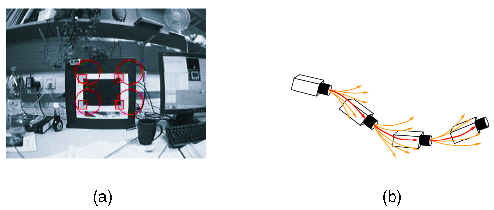

> [!note] Параметры мишени из сопровождающего кода
> В самой статье численные размеры мишени не приведены. В конфигурации
> оригинальной программы четыре угла чёрного прямоугольника имеют координаты
> $(\pm 0{,}105,\ \pm 0{,}07425,\ 0)$ м. Следовательно, размер прямоугольника
> составляет $0{,}210 \times 0{,}1485$ м, то есть **210 x 148,5 мм**. Номинальная
> начальная поза камеры задана на расстоянии около $0{,}60$ м от плоскости
> мишени. Это параметры из кода, а не из текста статьи.
>
> Используемая нами компактная реализация инициализируется иначе: она находит
> внутренние углы шахматной доски, вычисляет позу через `solvePnP` и использует
> известный размер клетки. Поэтому доска `8 x 8` с клеткой `33,5` мм является
> заменой оригинальной четырёхточечной мишени, а не её точной копией.

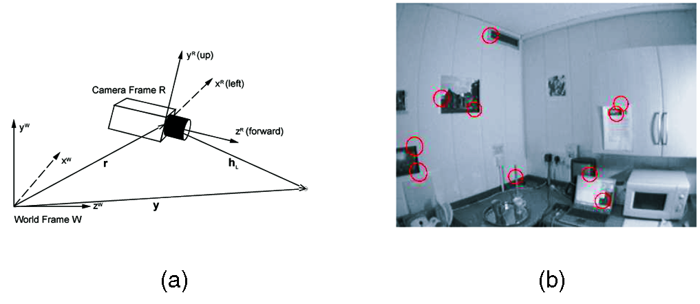

Известные признаки мишени помещаются в карту при запуске с нулевой неопределённостью. Эти признаки фактически задают мировую систему координат SLAM. В первом кадре камера удерживается в примерно известном положении относительно мишени. В векторе состояния начальной позе камеры задаётся неопределённость в несколько градусов и сантиметров. Этого достаточно, чтобы трекинг надёжно «зацепился» на первом кадре обычным циклом работы.

#### Фактическая инициализация в запускаемом проекте

Программа получает четыре аргумента:

```text
monoslam cameraFile patternRows patternCols squareSize
```

Для нашей доски команда передаёт `8 8 0.0335`. В `main.cpp` число клеток
преобразуется в число внутренних углов:

```cpp
Size patternSize(patternCols - 1, patternRows - 1);
```

Поэтому для доски $8\times8$ OpenCV ищет решётку $7\times7$ внутренних углов.

Сначала из XML загружаются разрешение, матрица внутренних параметров и
коэффициенты дисторсии:

```cpp
FileStorage fs(cameraFile, FileStorage::READ);

Size frameSize;
Mat K, distCoeffs;

fs["Image_Size"] >> frameSize;
fs["Intrinsic_Matrix"] >> K;
fs["Distortion_Coefficients"] >> distCoeffs;
```

Затем создаётся `Map` с фактическими параметрами реализации:

```cpp
int patchSize = 22;
int minDensity = 8;
int maxDensity = 18;
double failTolerance = 0.5;

Mat accelerationVariances =
    (Mat_<double>(6, 1) << 0.025, 0.025, 0.025,
                             0.6,   0.6,   0.6);

Mat measurementNoiseVariances =
    (Mat_<double>(2, 1) << 9, 9);

Map map(K, distCoeffs, frameSize,
        patchSize, minDensity, maxDensity, failTolerance,
        accelerationVariances, measurementNoiseVariances);
```

Значения `9, 9` являются дисперсиями пиксельного измерения, поэтому стандартное
отклонение по каждой координате равно $3$ пикселям.

До успешного распознавания доски программа остаётся в цикле:

```cpp
for (;;) {
    if (!readFrame(cap, frame))
        break;

    cvtColor(frame, gray, COLOR_BGR2GRAY);

    if ((init = map.initMap(gray, patternSize, squareSize, var)))
        break;

    if (waitKey(1) == 27)
        break;
}
```

Внутри `Map::initMap()` выполняются четыре ключевых шага.

**Шаг 1. Поиск внутренних углов и субпиксельное уточнение:**

```cpp
bool patternFound = findChessboardCorners(
    frame, patternSize, imageCorners,
    CALIB_CB_ADAPTIVE_THRESH +
    CALIB_CB_NORMALIZE_IMAGE +
    CALIB_CB_FAST_CHECK);

if (!patternFound)
    return false;

cornerSubPix(frame, imageCorners,
             Size(11, 11), Size(-1, -1),
             TermCriteria(TermCriteria::EPS +
                          TermCriteria::MAX_ITER, 30, 0.1));
```

**Шаг 2. Построение метрических координат плоской решётки:**

```cpp
for (int i = 0; i < h; i++)
    for (int j = 0; j < w; j++)
        worldCorners.push_back(
            Point3d(squareSize * i, squareSize * j, 0));
```

При $w=h=7$ и стороне клетки $0{,}0335$ м крайние внутренние углы разделены на

$$
(7-1)\cdot0{,}0335=0{,}201\text{ м}.
$$

Следовательно, используемая при инициализации плоская область внутренних углов
имеет размер $201\times201$ мм. Внешняя граница бумажной доски в расчёт позы не
входит.

**Шаг 3. Оценка позы камеры через PnP:**

```cpp
bool poseFound = solvePnP(worldCorners, imageCorners,
                          camera.K, camera.distCoeffs,
                          rvec, tvec, false,
                          SOLVEPNP_ITERATIVE);

Rodrigues(rvec, R);
t = -R.t() * tvec;
Mat q = quaternionInv(computeQuaternion(rvec));

t.copyTo(x(Rect(0, 0, 1, 3)));
q.copyTo(x(Rect(0, 3, 1, 4)));
```

`solvePnP()` возвращает преобразование из мира в камеру. Выражение
$t=-R^\top t_{vec}$ переводит его в положение камеры в мировой системе.

Начальные линейная и угловая скорости остаются нулевыми. Ковариация камеры
задаётся диагональной матрицей из `main.cpp`:

```cpp
vector<double> var({
    0.0001, 0.0001, 0.0001,       // положение
    0., 0., 0., 0.,               // кватернион
    0.0001, 0.0001, 0.0001,       // линейная скорость
    0.008, 0.008, 0.008            // угловая скорость
});

P = Mat::diag(Mat(var));
```

**Шаг 4. Добавление пяти известных признаков:**

```cpp
idx = 0;             // верхний левый
addInitialFeature(...);

idx = w - 1;         // верхний правый
addInitialFeature(...);

idx = (h - 1) * w;   // нижний левый
addInitialFeature(...);

idx = w * h - 1;     // нижний правый
addInitialFeature(...);

idx = w * ((h - 1) / 2) + (w + 1) / 2 - 1; // центральный
addInitialFeature(...);
```

Каждая точка добавляет три строки в `x` и три строки и столбца в `P`:

```cpp
x.resize(x.rows + 3);
Mat(3, 1, CV_64FC1, pos3D_)
    .copyTo(x(Rect(0, x.rows - 3, 1, 3)));

Mat tmp(P.rows + 3, P.cols + 3, CV_64FC1, Scalar(0));
P.copyTo(tmp(Rect(0, 0, P.cols, P.rows)));
P = tmp;
```

Новые строки и столбцы заполнены нулями: начальные точки считаются известными
точно. Для их плоских патчей задаётся нормаль

```cpp
Mat normal = (Mat_<double>(3, 1) << 0, 0, 1);
```

После пяти признаков состояние имеет размер

$$
13+5\cdot3=28.
$$

> [!important] Статья и код используют разные стартовые мишени
> В статье четыре угла чёрного прямоугольника заранее записаны в конфигурации.
> Запускаемый проект автоматически находит 49 внутренних углов шахматной доски,
> оценивает позу по всем 49, а в EKF добавляет только пять из них. Назначение
> одинаково — задать масштаб, мировую систему координат и первые ориентиры, —
> но конкретный механизм различается.

### 3.4. Модель движения и прогноз

После запуска состояние обновляется двумя чередующимися шагами:

- прогноз: камера движется в «слепом» интервале между кадрами;
- обновление: после измерения признаков в новом изображении.

Для свободно движущейся камеры нет управляющих команд, как у колёсного робота. Но это не делает модель невозможной. Любая физическая модель останавливается на некотором уровне детализации, а остаток описывает вероятностным шумом процесса. Для колёсного робота шум отражает проскальзывание, неровности и другие неучтённые эффекты. Для ручной или роботизированной камеры шум отражает неизвестные намерения и динамику носителя камеры.

Авторы используют модель **постоянной линейной и угловой скорости**. Это не означает, что камера всегда движется с одной скоростью. Это означает, что за один небольшой шаг времени неопределённые ускорения моделируются как гауссовы случайные величины с нулевым средним. Тем самым задаётся ожидание плавности движения: очень большие ускорения считаются маловероятными.

Пусть на каждом шаге неизвестные линейное ускорение $a^W$ и угловое ускорение $\alpha^R$ создают импульсы скорости и угловой скорости:

$$
n =
\begin{pmatrix}
V^W\\
\Omega^R
\end{pmatrix}
=
\begin{pmatrix}
a^W \Delta t\\
\alpha^R \Delta t
\end{pmatrix}.
\tag{3}
$$

В текущей реализации ковариация шума $P_n$ считается диагональной: шумы по линейным и вращательным компонентам не коррелированы. Обновление состояния камеры задаётся так:

$$
f_v =
\begin{pmatrix}
r^W_{\text{new}}\\
q^{WR}_{\text{new}}\\
v^W_{\text{new}}\\
\omega^R_{\text{new}}
\end{pmatrix}
=
\begin{pmatrix}
r^W + (v^W + V^W)\Delta t\\
q^{WR} \times q\left((\omega^R + \Omega^R)\Delta t\right)\\
v^W + V^W\\
\omega^R + \Omega^R
\end{pmatrix}.
\tag{4}
$$

Здесь $q((\omega^R + \Omega^R)\Delta t)$ — кватернион, соответствующий повороту, заданному вектором угла-оси $(\omega^R + \Omega^R)\Delta t$.

В EKF новый прогноз состояния должен сопровождаться ростом неопределённости. Ковариация шума процесса для камеры вычисляется через якобиан:

$$
Q_v =
\frac{\partial f_v}{\partial n}
P_n
\left(\frac{\partial f_v}{\partial n}\right)^\top.
\tag{5}
$$

Для EKF также нужен якобиан $\partial f_v / \partial x_v$. Авторы не приводят его полностью, потому что это громоздкое, но прямое дифференцирование.

Размер $P_n$ задаёт ожидаемую плавность движения. Малый $P_n$ хорошо подходит для плавного движения, но плохо переносит резкие ускорения. Большой $P_n$ позволяет пережить быстрые движения, но неопределённость резко растёт, и системе нужно больше качественных измерений в каждом кадре.

#### Реализация прогноза EKF

В запускаемом проекте весь шаг прогноза помещается в четыре операции:

```cpp
void Map::predict(double dt) {
    Mat F = computeProcessMatrix(dt);
    Mat N = computeProcessNoiseMatrix(dt, F);

    P = F * P * F.t() + N;
    applyMotionModel(dt);
}
```

Здесь используются обозначения:

$$
F_k=\left.\frac{\partial f}{\partial x}\right|_{\hat x^+_k},
$$

$$
N_k=G_kQ_kG_k^\top,
\qquad
G_k=\left.\frac{\partial f}{\partial n}\right|_{\hat x^+_k},
$$

$$
P^-_{k+1}=F_kP^+_kF_k^\top+N_k.
$$

В коде `N` соответствует добавочному шуму $GQG^\top$, а не пиксельному шуму
измерения. Буква `R` в классе `Map` используется уже для измерительного шума.

##### Что означает линеаризация

Функция движения нелинейна из-за кватернионного поворота. EKF заменяет её в
окрестности текущей оценки линейным приближением:

$$
f(x+\delta x)\approx f(x)+F\delta x.
$$

Матрица $F$ показывает, как небольшая ошибка каждой компоненты старого состояния
переносится в ошибку нового состояния. Именно поэтому `computeProcessMatrix()`
вызывается **до** `applyMotionModel()`: производные должны быть вычислены в старой
апостериорной оценке $\hat x_k^+$.

##### Применение среднего движения

Среднее состояние распространяется функцией:

```cpp
void Map::applyMotionModel(double dt) {
    x(Rect(0, 0, 1, 3)) +=
        x(Rect(0, 7, 1, 3)) * dt;

    if (x.at<double>(10, 0) != 0 ||
        x.at<double>(11, 0) != 0 ||
        x.at<double>(12, 0) != 0)
        x(Rect(0, 3, 1, 4)) = quaternionMultiply(
            x(Rect(0, 3, 1, 4)),
            computeQuaternion(x(Rect(0, 10, 1, 3)) * dt));
}
```

То есть:

$$
r_{k+1}=r_k+v_k\Delta t,
$$

$$
q_{k+1}=q_k\otimes q(\omega_k\Delta t).
$$

Скорости `v` и `w` не изменяются, поскольку математическое ожидание случайного
ускорения равно нулю. Положения признаков также не изменяются: сцена считается
статической.

Функция `computeQuaternion()` переводит вектор угла-оси в кватернион:

```cpp
double angle = sqrt(x*x + y*y + z*z);
double c = cos(0.5 * angle);
double s = sin(0.5 * angle);

double q[] = {
    c,
    s*x/angle,
    s*y/angle,
    s*z/angle
};
```

Это реализация формулы

$$
q(\theta)=
\begin{pmatrix}
\cos(\|\theta\|/2)\\
\dfrac{\theta}{\|\theta\|}\sin(\|\theta\|/2)
\end{pmatrix}.
$$

Вызов защищён проверкой ненулевой угловой скорости, поэтому деления на ноль в
этом месте не происходит.

##### Построение якобиана перехода $F$

Сначала создаётся единичная матрица размером всего состояния:

```cpp
Mat F = Mat::eye(P.size(), CV_64FC1);
```

Это сразу задаёт неизменность скоростей и всех 3D-признаков. Затем добавляется
зависимость нового положения от старой линейной скорости:

```cpp
F.at<double>(0, 7) = dt;
F.at<double>(1, 8) = dt;
F.at<double>(2, 9) = dt;
```

То есть блок

$$
\frac{\partial r_{k+1}}{\partial v_k}
=\Delta t I_3.
$$

Для ориентации нужно дифференцировать произведение
$q_k\otimes q(\omega_k\Delta t)$. Код строит две матрицы:

```cpp
Mat Q1(4, 4, CV_64FC1); // D(q_new) / D(q_delta)
Mat Q2(4, 3, CV_64FC1); // D(q_delta) / D(w_old)

// ... заполнение Q1 и Q2 ...

F(Rect(10, 3, 3, 4)) = Q1 * Q2;
```

Произведение реализует цепное правило:

$$
\frac{\partial q_{k+1}}{\partial\omega_k}
=
\frac{\partial(q_k\otimes q_\Delta)}{\partial q_\Delta}
\frac{\partial q_\Delta}{\partial\omega_k}.
$$

При нулевой угловой скорости используется предел производной около единичного
кватерниона:

```cpp
Q2.setTo(Scalar(0));
Q2.at<double>(1, 0) = 0.5 * dt;
Q2.at<double>(2, 1) = 0.5 * dt;
Q2.at<double>(3, 2) = 0.5 * dt;
```

При ненулевой скорости код аналитически вычисляет производные синуса, косинуса и
нормированного направления $\omega/\|\omega\|$. Одновременно блок
$\partial q_{k+1}/\partial q_k$ заполняется матрицей правого умножения на
$q(\omega\Delta t)$.

Итоговая структура $F$ имеет вид

$$
F=
\begin{pmatrix}
I_3 & 0 & \Delta t I_3 & 0 & 0\\
0 & F_{qq} & 0 & F_{q\omega} & 0\\
0 & 0 & I_3 & 0 & 0\\
0 & 0 & 0 & I_3 & 0\\
0 & 0 & 0 & 0 & I_{3N}
\end{pmatrix}.
$$

##### Шум процесса

В `main.cpp` передаются шесть величин:

```cpp
Mat accelerationVariances =
    (Mat_<double>(6, 1) <<
        0.025, 0.025, 0.025,
        0.6,   0.6,   0.6);
```

Конструктор превращает их в диагональную матрицу:

```cpp
A = cv::Mat::diag(accelerationVariances);
```

Далее `computeProcessNoiseMatrix()` формирует якобиан шума. Его верхняя часть
`W0` связывает импульсы линейной и угловой скорости с положением и
ориентацией:

```cpp
Mat W0(7, 6, CV_64FC1, Scalar(0));

W0.at<double>(0, 0) = dt;
W0.at<double>(1, 1) = dt;
W0.at<double>(2, 2) = dt;

F(Rect(10, 3, 3, 4))
    .copyTo(W0(Rect(3, 3, 3, 4)));

Mat Q = A * dt * dt;
```

Полный якобиан можно представить как

$$
G=
\begin{pmatrix}
W_0\\
I_6\\
0_{3N\times6}
\end{pmatrix}.
$$

Код не собирает $G$ явно, а сразу раскладывает произведение $GQG^\top$ по
блокам:

```cpp
Mat W0_Q = W0 * Q;
Mat W0_Q_t = W0_Q.t();
Mat W0_Q_W0 = W0_Q * W0.t();

Mat N(P.size(), CV_64FC1, Scalar(0));

W0_Q_W0.copyTo(N(Rect(0, 0, 7, 7)));
W0_Q.copyTo(N(Rect(7, 0, 6, 7)));
W0_Q_t.copyTo(N(Rect(0, 7, 7, 6)));
Q.copyTo(N(Rect(7, 7, 6, 6)));
```

Нулевые строки и столбцы признаков означают, что собственный процессный шум для
неподвижных точек не добавляется. Но их ковариации с камерой всё равно
переносятся умножением $FPF^\top$.

> [!warning] Отличие параметров от статьи
> В разделе с экспериментами статья сообщает другие эмпирические значения шума.
> Компактный проект использует `0.025` и `0.6` как диагональные элементы `A`.
> Поэтому динамическая настройка запускаемого кода не является буквальным
> воспроизведением параметров авторской системы.

### 3.5. Активное измерение признаков и обновление карты

В этом разделе рассматривается измерение признака, который уже находится в SLAM-карте. Инициализация новых признаков описана далее.

Ключевая часть метода — заранее предсказать положение каждого признака на изображении и только потом решать, какие признаки измерять. Само сопоставление выполняется нормализованной взаимной корреляцией между текущим изображением и шаблоном признака, спроецированным в текущую оценку камеры.

Поиск шаблона дорогой, поэтому прогноз используется как активный механизм: система не сканирует всё изображение, а ищет только в небольшой области, где признак вероятен.

Пусть есть оценка положения камеры $x_v$ и положение признака $y_i$. Ожидаемое положение признака относительно камеры:

$$
h_L^R =
R^{RW}\left(y_i^W - r^W\right).
\tag{6}
$$

Для перспективной камеры ожидаемые координаты признака на изображении задаются моделью pinhole:

$$
h_i =
\begin{pmatrix}
u\\
v
\end{pmatrix}
=
\begin{pmatrix}
u_0 - f k_u \dfrac{h_{Lx}^R}{h_{Lz}^R}\\
v_0 - f k_v \dfrac{h_{Ly}^R}{h_{Lz}^R}
\end{pmatrix}.
\tag{7}
$$

Здесь $f k_u$, $f k_v$, $u_0$ и $v_0$ — параметры калибровки камеры.

В экспериментах авторы часто используют широкоугольные камеры с полем зрения почти 100 градусов. Они дают большую пользу для SLAM: признаки под сильно разными углами могут наблюдаться одновременно, поэтому оценки камеры и карты лучше ограничены. Но широкоугольные изображения плохо описываются простой перспективной моделью: прямые линии мира становятся кривыми на изображении.

Поэтому после перспективной проекции координаты $(u, v)$ дополнительно искажаются радиальной моделью, чтобы получить финальную прогнозируемую позицию $(u_d, v_d)$:

$$
u_d - u_0 =
\frac{u - u_0}{\sqrt{1 + 2K_1 r^2}},
\tag{8}
$$

$$
v_d - v_0 =
\frac{v - v_0}{\sqrt{1 + 2K_1 r^2}},
\tag{9}
$$

где

$$
r =
\sqrt{(u-u_0)^2 + (v-v_0)^2}.
\tag{10}
$$

Для камеры из эксперимента типичные параметры при разрешении $320 \times 240$: $f k_u = f k_v = 195$ пикселей, $(u_0, v_0) = (162, 125)$, $K_1 = 6 \times 10^{-6}$.

Якобианы этой функции проекции по состоянию камеры и признака позволяют вычислить неопределённость прогнозируемой позиции признака на изображении. Она задаётся симметричной матрицей ковариации инновации $S_i$ размером $2 \times 2$:

$$
\begin{aligned}
S_i ={}&
\frac{\partial u_{di}}{\partial x_v}
P_{xx}
\left(\frac{\partial u_{di}}{\partial x_v}\right)^\top
+
\frac{\partial u_{di}}{\partial x_v}
P_{xy_i}
\left(\frac{\partial u_{di}}{\partial y_i}\right)^\top\\
&+
\frac{\partial u_{di}}{\partial y_i}
P_{y_i x}
\left(\frac{\partial u_{di}}{\partial x_v}\right)^\top
+
\frac{\partial u_{di}}{\partial y_i}
P_{y_i y_i}
\left(\frac{\partial u_{di}}{\partial y_i}\right)^\top
+
R.
\end{aligned}
\tag{11}
$$

Матрица $R$ — постоянная ковариация шума измерения. Она берётся диагональной, а её величина определяется разрешением изображения.

$S_i$ даёт эллиптическую область поиска. Если взять, например, область в несколько стандартных отклонений, обычно $3\sigma$, то с высокой вероятностью признак должен находиться внутри соответствующего эллипса. В MonoSLAM корреляционный поиск всегда выполняется только в таких ограниченных областях. Это повышает скорость и снижает вероятность ложных сопоставлений.

Кроме того, $S_i$ показывает ожидаемую информативность измерения. Если ковариация инновации большая, результат измерения труднее предсказать, а значит оно сильнее уменьшит неопределённость карты. Когда доступно много кандидатов, система выбирает признаки с высокой $S_i$ и ограничивает число поисков примерно 10-12 за кадр. Так алгоритм старается уменьшать неопределённость вдоль наиболее «длинной» оси.

Авторы сравнивают этот подход с быстрыми bottom-up детекторами, которые обрабатывают всё изображение без разбора. Активный поиск почти всегда уменьшает объём обработки изображения, но требует дополнительных вычислений для прогноза областей поиска. Если камера полностью потеряна и неопределённость очень велика, активный поиск уже не подходит: тогда нужен отдельный механизм повторной локализации.

#### Реализация измерения и коррекции EKF

Функция `Map::update()` реализует следующий конвейер:

```text
проекция 3D-точек
        ↓
линеаризация h(x), построение H
        ↓
S = HPHᵀ + R
        ↓
эллиптические области поиска
        ↓
деформация и сопоставление патчей
        ↓
инновация y = z - h(x)
        ↓
K = PHᵀS⁻¹
        ↓
коррекция x и P
```

##### Проекция признаков

Сначала `computeMeasurementMatrix()` берёт предсказанную позу камеры и все
трёхмерные признаки:

```cpp
Mat R = getRotationMatrix(x(Rect(0, 3, 1, 4))).t();
Mat t = x(Rect(0, 0, 1, 3));

vector<Point3d> points3D_(features.size());

for (unsigned int i = 0; i < points3D_.size(); i++)
    points3D_[i] = Point3d(
        x(Rect(0, 13 + 3*i, 1, 3)));

camera.projectPoints(R, t, points3D_, points2D_);
```

В `Camera::projectPoints()` точка сначала переводится из мира в камеру:

```cpp
Mat pCam = R * (Mat(points3D[i]) - t);

double xn = pCam.at<double>(0, 0) /
            pCam.at<double>(2, 0);
double yn = pCam.at<double>(1, 0) /
            pCam.at<double>(2, 0);
```

То есть

$$
p^C=R^{CW}(p^W-t^W),
\qquad
x_n=\frac{X_C}{Z_C},
\quad
y_n=\frac{Y_C}{Z_C}.
$$

Далее используется не однопараметрическая модель статьи, а стандартная модель
дисторсии OpenCV с коэффициентами $k_1,k_2,p_1,p_2,k_3$:

```cpp
double r2 = xn*xn + yn*yn;
double r4 = r2 * r2;
double r6 = r4 * r2;

double u = xn * (1 + k1*r2 + k2*r4 + k3*r6)
         + 2*p1*xn*yn + p2*(r2 + 2*xn*xn);

double v = yn * (1 + k1*r2 + k2*r4 + k3*r6)
         + 2*p2*xn*yn + p1*(r2 + 2*yn*yn);

u = fx*u + cx;
v = fy*v + cy;
```

В формулах это

$$
r^2=x_n^2+y_n^2,
$$

$$
x_d=x_n(1+k_1r^2+k_2r^4+k_3r^6)
    +2p_1x_ny_n+p_2(r^2+2x_n^2),
$$

$$
y_d=y_n(1+k_1r^2+k_2r^4+k_3r^6)
    +2p_2x_ny_n+p_1(r^2+2y_n^2),
$$

$$
u=f_xx_d+c_x,
\qquad
v=f_yy_d+c_y.
$$

Точки, чьи проекции попадают внутрь прямоугольника кадра, добавляются в
`inviewIndices` и `inviewPos`:

```cpp
Rect box(Point2i(0, 0), camera.frameSize);

for (unsigned int i = 0; i < points2D_.size(); i++) {
    if (box.contains(points2D_[i])) {
        inviewIndices.push_back(i);
        inviewPos.push_back(points2D_[i]);
        points3D.push_back(points3D_[i]);
    }
}
```

##### Линеаризация измерения

Для $M$ признаков, предсказанных внутри кадра, создаётся матрица

```cpp
Mat H(2 * inviewIndices.size(), x.rows,
      CV_64FC1, Scalar(0));
```

её размер равен

$$
H\in\mathbb R^{2M\times(13+3N)}.
$$

Две строки каждого блока соответствуют производным $u_i$ и $v_i$. Ненулевыми
должны быть только столбцы положения камеры, кватерниона и конкретной 3D-точки:

$$
H_i=
\begin{pmatrix}
\dfrac{\partial u_i}{\partial r} &
\dfrac{\partial u_i}{\partial q} &
0_{1\times6} &
\cdots &
\dfrac{\partial u_i}{\partial y_i} &
\cdots\\[4pt]
\dfrac{\partial v_i}{\partial r} &
\dfrac{\partial v_i}{\partial q} &
0_{1\times6} &
\cdots &
\dfrac{\partial v_i}{\partial y_i} &
\cdots
\end{pmatrix}.
$$

Скорости не входят непосредственно в функцию измерения одного кадра, поэтому их
столбцы в $H$ нулевые. Они всё равно корректируются через корреляции в $P$.

Код сначала получает производные матрицы поворота по четырём компонентам
кватерниона:

```cpp
Mat R1, R2, R3, R4;
getRotationMatrixDerivatives(
    x(Rect(0, 3, 1, 4)), R1, R2, R3, R4);
```

Затем применяется правило производной отношения. Например,
$x_n=X_C/Z_C$, поэтому

$$
\frac{\partial x_n}{\partial a}
=
\frac{dfrac{\partial X_C}{\partial a}Z_C
      -X_Cdfrac{\partial Z_C}{\partial a}}
     {Z_C^2}.
$$

В коде производные по положению камеры выглядят так:

```cpp
double dxndr1 =
    (R.at<double>(2, 0) * xCam
     - R.at<double>(0, 0) * zCam) / zCam2;

double dyndr1 =
    (R.at<double>(2, 0) * yCam
     - R.at<double>(1, 0) * zCam) / zCam2;
```

А производные по первой компоненте кватерниона используют
$\partial R/\partial q_1$:

```cpp
Mat pBar1 = R1 * pt;

double dxndq1 =
    (pBar1.at<double>(0, 0) * zCam
     - pBar1.at<double>(2, 0) * xCam) / zCam2;

double dyndq1 =
    (pBar1.at<double>(1, 0) * zCam
     - pBar1.at<double>(2, 0) * yCam) / zCam2;
```

После дифференцирования радиальной и тангенциальной дисторсии получается,
например:

```cpp
double dudr1 = fx * (
    dxndr1*a
    + xn*dr2dr1*b
    + p1*ddr1
    + p2*(dr2dr1 + 4*xn*dxndr1));

double dudx1 = -dudr1;
```

Равенство `dudx1 = -dudr1` возникает потому, что проекция зависит от разности
$p^W-t^W$: перемещение точки и камеры в одном направлении производит
противоположный эффект.

Полученные производные записываются в строки $H$:

```cpp
H.at<double>(2*i, 0) = dudr1;
H.at<double>(2*i, 1) = dudr2;
H.at<double>(2*i, 2) = dudr3;
H.at<double>(2*i, 3) = dudq1;
H.at<double>(2*i, 4) = dudq2;
H.at<double>(2*i, 5) = dudq3;
H.at<double>(2*i, 6) = dudq4;

H.at<double>(2*i, 13 + 3*i)     = dudx1;
H.at<double>(2*i, 13 + 3*i + 1) = dudx2;
H.at<double>(2*i, 13 + 3*i + 2) = dudx3;
```

Для $v$ заполняется следующая строка аналогичным образом.

> [!bug] Ошибка фактической реализации
> Здесь `i` является номером точки среди попавших в кадр, а не её индексом в
> `features`. Если более ранний признак находится вне кадра, блок записывается не
> в те столбцы. Правильное смещение должно использовать
> `13 + 3 * inviewIndices[i]`. Эта задача записана в
> [[MonoSLAM_технический_долг]].

##### Ковариация инновации и эллипсы

В `update()` измерительный шум повторяется для каждого видимого признака:

```cpp
Mat N(H.rows, H.rows, CV_64FC1, Scalar(0));

for (int i = 0; i < N.rows / 2; i++) {
    N.at<double>(2*i, 2*i) = R.at<double>(0, 0);
    N.at<double>(2*i + 1, 2*i + 1) = R.at<double>(1, 0);
}

Mat S = H * P * H.t() + N;
```

Здесь локальная переменная `N` фактически является полной матрицей
измерительного шума $R_M$. Она не связана с `N`, использованной в функции
прогноза для шума процесса.

Полная матрица $S\in\mathbb R^{2M\times2M}$ содержит не только неопределённость
каждой проекции, но и взаимные корреляции измерений. Для отдельного эллипса код
берёт диагональный блок $2\times2$:

```cpp
Mat Si = S(Rect(2*i, 2*i, 2, 2));
eigen(Si, eigenval, eigenvec);

double majorAxis = 4 * sqrt(eigenval.at<double>(0));
double minorAxis = 4 * sqrt(eigenval.at<double>(1));
```

`RotatedRect` хранит полные длины осей, поэтому полуоси эллипса равны
$2\sqrt{\lambda_1}$ и $2\sqrt{\lambda_2}$. Это область радиуса примерно
$2\sigma$, охватывающая для двумерной гауссовой величины около 86% вероятности.
Она меньше часто используемой области $3\sigma$.

##### Деформация и поиск патча

Для каждого прогнозируемого признака код получает исходный кадр, прямоугольник
патча и исходную позу, а затем переносит патч в текущий вид:

```cpp
Mat p = x(Rect(0, 13 + 3*idx, 1, 3));
Mat n = feature->normal;
Mat view1 = feature->image;
Rect patch1 = feature->roi;
Mat R1 = feature->R;
Mat t1 = feature->t;
Mat R2 = getRotationMatrix(
    x(Rect(0, 3, 1, 4))).t();
Mat t2 = x(Rect(0, 0, 1, 3));

Mat templ = camera.warpPatch(
    p, n, view1, patch1,
    R1, t1, R2, t2, u, v);
```

Эллипс превращается в ограничивающий прямоугольник, расширенный так, чтобы в нём
целиком помещался шаблон:

```cpp
Rect roi = getBoundingBox(ellipses[i], gray.size());
Mat image = gray(roi);

Mat ccorr;
matchTemplate(image, templ, ccorr, TM_CCORR_NORMED);

double maxVal;
Point2i maxLoc;
minMaxLoc(ccorr, NULL, &maxVal, NULL, &maxLoc);
```

Измерение принимается при

```cpp
if (maxVal > 0.5) {
    int px = maxLoc.x + roi.x + u;
    int py = maxLoc.y + roi.y + v;

    residuals.push_back(Point2d(
        px - inviewPos[i].x,
        py - inviewPos[i].y));
}
```

Таким образом, инновация для признака равна

$$
y_i=
\begin{pmatrix}
u_i^{\text{meas}}-u_i^{\text{pred}}\\
v_i^{\text{meas}}-v_i^{\text{pred}}
\end{pmatrix}.
$$

Неудачные измерения не должны участвовать в коррекции, поэтому их пары строк
удаляются из $H$, а строки и столбцы — из $S$:

```cpp
H = removeRows(H, failedInviewIndices, 2);
S = removeRowsCols(S, failedInviewIndices, 2);
```

##### Коррекция EKF

После удаления неудачных наблюдений размеры матриц для $m$ успешных признаков
равны:

| Величина | Размер |
|---|---:|
| `x` | $(13+3N)\times1$ |
| `P` | $(13+3N)\times(13+3N)$ |
| `H` | $2m\times(13+3N)$ |
| `S` | $2m\times2m$ |
| `y` | $2m\times1$ |
| `K` | $(13+3N)\times2m$ |

Текущий код выполняет:

```cpp
Mat K = P * H.t() * S.inv();

x += K * y;
P -= K * H * P;
```

что соответствует формулам

$$
K=P^-H^\top S^{-1},
$$

$$
x^+=x^-+Ky,
$$

$$
P^+=(I-KH)P^-.
$$

Поскольку `P` полная, одно пиксельное измерение может исправить не только
наблюдаемую точку и текущую позу, но также скорости и другие признаки через
накопленные корреляции.

После коррекции кватернион может перестать иметь единичную норму. Поэтому код
нормализует его и распространяет это нелинейное преобразование на ковариацию:

```cpp
normalize(q, q);
P = J * P * J.t();
```

где

$$
J=\frac{\partial(q/\|q\|)}{\partial q}
$$

вставлен в соответствующий блок единичной матрицы полного состояния.

> [!warning] Численная устойчивость
> Фактическая реализация явно вычисляет `S.inv()` и использует сокращённую форму
> обновления ковариации. Рабочая доработка должна решать систему через разложение
> Холецкого и использовать форму Джозефа. Это уже зафиксировано в
> [[MonoSLAM_технический_долг]].

> [!warning] Активный выбор реализован не полностью
> Статья выбирает ограниченное число наиболее информативных признаков. Этот код
> строит эллипсы и ограничивает область поиска, но затем пытается измерить **все**
> признаки, проекции которых попали в кадр. Ранжирования по информативности $S_i$
> и ограничения до 10–12 поисков здесь нет.

### 3.6. Инициализация признаков

В монокулярной камере модель измерения нельзя напрямую обратить, чтобы получить 3D-положение нового признака: глубина неизвестна. Чтобы оценить глубину, камера должна сместиться, а признак должен быть измерен с нескольких точек зрения.

Обычный путь — несколько кадров отслеживать новый признак в 2D, а затем триангулировать его глубину по нескольким наблюдениям. Авторы избегают этого, потому что такой подход нарушает их top-down-логику и теряет доступную информацию. При быстром движении камеры 2D-отслеживание само по себе может быть сложным, а признаки иногда нужно инициализировать очень быстро, пока они не вышли из поля зрения.

Вместо этого после первого обнаружения нового признака в карту добавляется 3D-луч, вдоль которого признак обязан лежать. Это полубесконечная линия: она начинается в оценённой позиции камеры и уходит в бесконечность вдоль направления наблюдения признака. Параметры этой линии также имеют гауссову неопределённость.

Представление частично инициализированного признака:

$$
y_{p_i} =
\begin{pmatrix}
r_i^W\\
\hat{h}_i^W
\end{pmatrix},
$$

где $r_i^W$ — положение начала луча, а $\hat{h}_i^W$ — единичный вектор его направления.

Все возможные 3D-положения признака лежат где-то на этом луче. Остаётся одна неизвестная степень свободы: глубина, то есть расстояние вдоль луча от его начала. Авторы представляют эту глубину дискретным набором гипотез, равномерно распределённых вдоль луча. Это можно понимать как одномерное распределение вероятности по глубине, заданное набором частиц или гистограммой.

Для гипотезы глубины $\lambda$ 3D-положение признака:

$$
y_{\lambda i} = r_i^W + \lambda \hat{h}_i^W.
$$

На следующих кадрах каждая гипотеза проецируется в изображение и получает собственную эллиптическую область поиска. Если камера широкоугольная и модель неперспективная, центры эллипсов могут лежать не на прямой, а на кривой. Это не проблема, потому что каждая гипотеза проверяется отдельно.

Для всех эллипсов выполняется корреляционный поиск одного и того же шаблона. Если области пересекаются, алгоритм не повторяет лишнюю обработку: он строит таблицу уже вычисленных корреляционных оценок. Сопоставление внутри каждого эллипса даёт правдоподобие гипотезы, после чего вероятности гипотез переоцениваются по правилу Байеса.

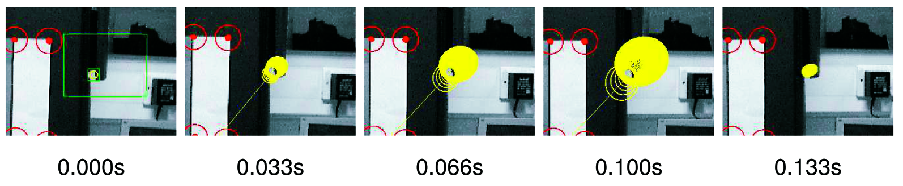

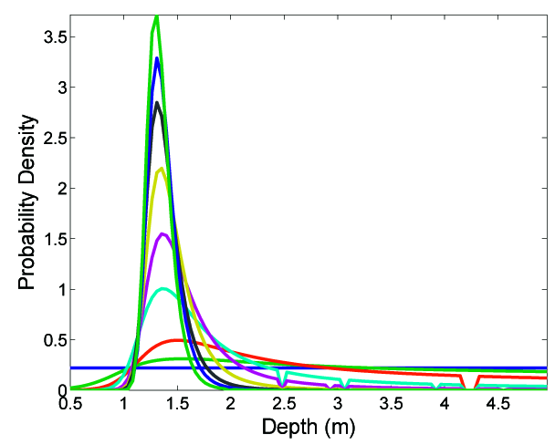

Когда отношение стандартного отклонения глубины к оценке глубины становится меньше порога, в работе используется значение 0.3, распределение можно безопасно приблизить гауссовым. После этого признак переводится в полностью инициализированное точечное представление в карте.

Сразу после такого перехода у признака обычно ещё большая неопределённость по глубине. На карте это выглядит как вытянутый эллипсоид вдоль направления наблюдения камеры. Но при дальнейшем движении камеры и новых измерениях эта неопределённость быстро уменьшается.

Главная польза метода — форма областей поиска. Априорное распределение по глубине позволяет не искать вдоль всей эпиполярной линии, ускоряя и стабилизируя инициализацию. На практике при типичных боковых движениях достаточно 2-4 кадров. При движении почти вдоль оптической оси метод работает хуже, потому что параллакс мал.

После первой публикации этого метода появились улучшения. Например, Sola et al. предложили представлять неопределённость нового признака набором перекрывающихся 3D-гауссиан вдоль луча, причём распределять их равномерно по обратной глубине. Montiel et al. затем показали, что параметризация через обратную глубину позволяет ещё проще и эффективнее инициализировать признаки внутри стандартного EKF.

#### Как инициализация новых признаков выполнена в запускаемом коде

> [!summary] Главное различие
> В статье реализован полный цикл: обнаружение точки, создание луча, многокадровое
> обновление вероятностей глубины и перевод сошедшегося кандидата в EKF-карту.
> Текущий проект реализует только первые два шага: он находит точки и создаёт для
> них лучи со 100 гипотезами глубины. Обработка этих гипотез на следующих кадрах
> пока отсутствует.

В основном цикле создание кандидатов вызывается перед чтением следующего кадра:

```cpp
// main.cpp
map.trackNewCandidates(gray);

if (!readFrame(cap, frame))
    break;

cvtColor(frame, gray, COLOR_BGR2GRAY);
map.predict(dt);
map.update(gray, frame);
```

Следовательно, исходный патч кандидата и луч строятся по текущему кадру `gray` и
последней исправленной оценке позы. После чтения нового кадра должны были бы
обновляться гипотезы глубины, но такого вызова в цикле нет.

##### 1. Условие создания кандидатов

```cpp
// map.cpp
bool Map::trackNewCandidates(const Mat& frame) {
    if (numVisibleFeatures >= minFeatureDensity)
        return false;

    if (!candidates.empty())
        return false;

    Mat corners = findCorners(frame);
    if (corners.empty())
        return false;

    // ... создание лучей и кандидатов ...
}
```

Для нашего запуска установлены

```text
minFeatureDensity = 8
maxFeatureDensity = 18
```

Новые точки ищутся, только если в предыдущем обновлении было успешно сопоставлено
меньше восьми признаков. Одновременно разрешён только один набор кандидатов:
непустой `candidates` полностью запрещает создание следующего набора.

##### 2. Переход от пикселя к лучу в пространстве

Угол Shi-Tomasi сначала переводится из искажённых пиксельных координат в
нормализованные координаты камеры:

```cpp
Mat undistorted;
undistortPoints(corners, undistorted, camera.K, camera.distCoeffs);

undistorted = undistorted.reshape(1).t();
undistorted.resize(3, Scalar(1));
```

После `undistortPoints()` каждая точка имеет вид

$$
\begin{pmatrix}x_n & y_n\end{pmatrix}^\top.
$$

Добавление третьей координаты, равной единице, превращает её в направление луча
в системе камеры:

$$
\tilde h^C=
\begin{pmatrix}
x_n\\y_n\\1
\end{pmatrix}.
$$

Затем код берёт текущую позицию камеры и переводит луч в мировую систему:

```cpp
Mat t = x(Rect(0, 0, 1, 3));
Mat R = getRotationMatrix(x(Rect(0, 3, 1, 4)));

undistorted.convertTo(undistorted, CV_64FC1);
Mat directions = R * undistorted;

for (int i = 0; i < directions.cols; i++)
    normalize(directions.col(i), directions.col(i));
```

Итоговый единичный вектор

$$
\hat h_i^W =
\frac{R^{WC}\tilde h_i^C}
{\left\|R^{WC}\tilde h_i^C\right\|}
$$

задаёт направление из центра камеры в сторону признака. Начало луча — текущая
позиция камеры $t=r_i^W$. Возможное положение точки при глубине $d_j$ равно

$$
y_{ij}^W=t+d_j\hat h_i^W.
$$

##### 3. Фактические гипотезы глубины

```cpp
Point2d depthInterval(0.05, 5);
int depthSamples = 100;

for (int i = 0; i < directions.cols; i++) {
    Point2i pixel(corners.at<Point2f>(i));

    candidates.push_back(Feature(
        frame,
        buildSquare(pixel, patchSize),
        R.t(),
        t,
        directions.col(i),
        depthInterval,
        depthSamples
    ));
}
```

Конструктор `Feature` сохраняет исходное изображение, патч, позу камеры и луч, а
затем равномерно заполняет массив глубин:

```cpp
// feature.cpp
depths.resize(depthSamples);

double step =
    (depthInterval.y - depthInterval.x) / (depthSamples - 1);

for (int i = 0; i < depthSamples; i++)
    depths[i] = depthInterval.x + step * i;

probs.resize(depthSamples, 1.0 / depthSamples);
```

В текущей конфигурации шаг равен

$$
\Delta d=\frac{5-0{,}05}{100-1}=0{,}05\text{ м},
$$

поэтому хранятся глубины $0{,}05; 0{,}10; \ldots; 5{,}00$ м с начальными
вероятностями

$$
p_j=\frac{1}{100}=0{,}01.
$$

Это отличается от иллюстрации статьи, где показан диапазон $0{,}5$-$5$ м.
Кроме того, гипотезы равномерны по обычной глубине, а не по обратной глубине.

##### 4. Где текущая реализация останавливается

После заполнения `depths` и `probs` эти поля больше нигде не используются. В
проекте нет кода, который должен выполнять следующие операции из статьи:

1. построить точки $y_{ij}^W=t+d_j\hat h_i^W$ для всех глубин;
2. спроецировать их в новый кадр;
3. построить область поиска для каждой гипотезы;
4. сравнить исходный патч с новым изображением;
5. получить правдоподобия $p(z_k\mid d_j)$;
6. выполнить байесовское обновление

$$
p(d_j\mid z_{1:k})=
\frac{p(z_k\mid d_j)p(d_j\mid z_{1:k-1})}
{\sum_l p(z_k\mid d_l)p(d_l\mid z_{1:k-1})};
$$

7. вычислить среднее и дисперсию глубины

$$
\hat d=\sum_j p_jd_j,
\qquad
\sigma_d^2=\sum_jp_j(d_j-\hat d)^2;
$$

8. проверить критерий статьи

$$
\frac{\sigma_d}{\hat d}<0{,}3;
$$

9. перевести луч в трёхмерную точку, расширить `x` и полную `P`, включая
   корреляции с камерой и остальными признаками.

> [!warning] Практическое следствие
> После инициализации по шахматной доске в карте находятся пять исходных
> признаков. Поскольку $5<8$, программа почти сразу создаёт кандидатов. Массив
> `candidates` после этого остаётся непустым навсегда, следующий набор создать
> нельзя, а существующие кандидаты никогда не переходят в `features`. Поэтому
> сейчас программа продолжает EKF-отслеживание только пяти точек шахматной
> доски и не строит естественную карту сцены.

Полный недостающий цикл зафиксирован в заметке
[[MonoSLAM_технический_долг#1. Завершить инициализацию новых признаков]].

### 3.7. Управление картой

Важная часть алгоритма — разумное управление количеством признаков. Система должна на лету решать, когда добавлять новые признаки и когда удалять старые.

Критерий управления картой стремится поддерживать число надёжных признаков, видимых из текущей области движения камеры, около заранее заданного значения. Это значение зависит от процесса измерения, требуемой точности локализации и доступной вычислительной мощности. Для широкоугольной камеры авторы нашли, что примерно 12 видимых признаков дают точную локализацию без перегрузки процессора.

«Видимость» здесь точнее понимать как прогнозируемую измеримость. Она вычисляется по относительному положению камеры и признака, а также по позиции камеры, из которой признак был впервые инициализирован. Признак должен попадать в изображение, и камера не должна слишком сильно сместиться от точки зрения, где этот признак был создан. Вращения система переносит лучше, но сильные изменения точки наблюдения могут сделать корреляцию ненадёжной.

Новые признаки добавляются только если в области, через которую проходит камера, видимых признаков меньше порога. Нет смысла без причины увеличивать число признаков и тем самым вычислительную сложность фильтра.

Для поиска нового признака запускается оператор Shi-Tomasi в ограниченном прямоугольнике изображения, примерно $80 \times 60$ пикселей. Положение этого прямоугольника выбирается случайно, но с ограничениями: он не должен перекрывать уже существующие признаки, и найденный в нём признак не должен сразу исчезнуть из поля зрения согласно текущей оценке скорости и угловой скорости камеры.

Признак удаляется, если после заданного числа попыток измерения, когда он должен быть видим, слишком большая доля попыток оказывается неудачной. В работе используется порог 50 процентов. Так удаляются плохие признаки: точки на границах окклюзии, признаки на движущихся объектах, блики на кривых поверхностях или часто закрываемые ориентиры.

Со временем в карте происходит своего рода естественный отбор: остаются стабильные, статичные и широко наблюдаемые точечные признаки. Если временный объект иногда закрывает ориентир, это обычно не страшно: измерение просто не удаётся и фильтр не обновляется. Проблемы возникают, если временный объект случайно похож на ориентир и происходит ложное сопоставление. Однако при хорошем трекинге такие ошибки редки, потому что шаблоны достаточно крупные и поиск обычно ограничен маленькими областями примерно 15-20 пикселей.

#### Как управление картой выполнено в запускаемом коде

Текущая версия использует те же общие идеи, но конкретные правила отличаются от
статьи.

| Элемент | В статье | В текущем коде |
|---|---|---|
| Целевое число видимых признаков | около 12 | диапазон от 8 до 18 |
| Область поиска нового угла | случайная область около $80\times60$ | почти весь кадр с маской |
| Детектор | Shi-Tomasi | `goodFeaturesToTrack`, то есть Shi-Tomasi |
| Минимальное расстояние между углами | определяется стратегией областей | 60 пикселей |
| Удаление | более 50% неудач | `matchingFails / matchingAttempts > 0.5` |
| Пополнение карты | полная инициализация луча | создаются только незавершённые кандидаты |

##### 1. Где разрешено искать новые точки

```cpp
int maxCorners = maxFeatureDensity - numVisibleFeatures;
int minDistance = 60;
double qualityLevel = 0.2;

Mat mask(frame.size(), CV_8UC1, Scalar(0));
int pad = 30;
mask(Rect(pad, pad,
          mask.cols - 2 * pad,
          mask.rows - 2 * pad)).setTo(Scalar(255));
```

В отличие от случайного прямоугольника статьи, код разрешает поиск почти по всему
кадру, оставляя 30-пиксельную границу. Затем вокруг каждого уже видимого
признака запрещается квадрат размером $120\times120$ пикселей:

```cpp
for (unsigned int i = 0; i < inviewPos.size(); i++) {
    Rect roi = buildSquare(inviewPos[i], 2 * minDistance);

    // roi обрезается по границам кадра
    mask(roi).setTo(Scalar(0));
}

goodFeaturesToTrack(
    frame, corners, maxCorners,
    qualityLevel, minDistance, mask
);
```

Число новых углов выбирается так, чтобы теоретически довести число признаков до
`maxFeatureDensity = 18`. Но из-за незавершённой инициализации эти углы остаются
кандидатами и фактическое число EKF-признаков не увеличивают.

##### 2. Как накапливается статистика сопоставления

У полностью инициализированного признака счётчики начинаются так:

```cpp
matchingFails = 0;
matchingAttempts = 1;
```

Если признак по прогнозу попал в кадр, при каждом вызове `update()` число попыток
увеличивается:

```cpp
feature->matchingAttempts++;
```

По замыслу функции при пустом деформированном шаблоне или корреляции не выше
`0.5` увеличивается число неудач:

```cpp
if (templ.empty()) {
    feature->matchingFails++;
    failedIndices.push_back(idx);
} else {
    matchTemplate(image, templ, ccorr, TM_CCORR_NORMED);
    minMaxLoc(ccorr, NULL, &maxVal, NULL, &maxLoc);

    if (maxVal <= 0.5) {
        feature->matchingFails++;
        failedIndices.push_back(idx);
    }
}
```

Однако в фактическом порядке выполнения `cvtColor(templ, ...)` вызывается до
`templ.empty()`. Поэтому пустой шаблон сейчас может сначала вызвать исключение
OpenCV и только после перестановки этой проверки будет штатно учитываться как
неудачное сопоставление. Это отдельно записано в
[[MonoSLAM_технический_долг#6. Защитить работу с пустым деформированным шаблоном]].

Признак, который предсказан вне кадра, в попытки и неудачи не попадает. Это
разумно: система не штрафует точку за то, что камера сейчас на неё не смотрит.

##### 3. Критерий удаления

```cpp
double numFails = features[idx].matchingFails;
double numAttemps = features[idx].matchingAttempts;

if (numFails / numAttemps > failTolerance) {
    badFeaturesVecIndices.push_back(idx);
    badFeaturesPosIndices.push_back(j);
}
```

При `failTolerance = 0.5` удаление происходит только после превышения 50%, а не
при точном равенстве. Например, $2/3$ приводит к удалению, а $2/4$ ещё нет.
Успешное сопоставление не сбрасывает счётчики: оценивается доля неудач за всё
время существования признака.

##### 4. Ошибка удаления из EKF-состояния

Далее функция действительно удаляет объекты из вектора `features`:

```cpp
removeIndices(features, badFeaturesVecIndices);
removeIndices(inviewPos, badFeaturesPosIndices);
```

После этого она пытается удалить соответствующие блоки из состояния:

```cpp
Mat x_Features = x(Rect(0, 13, 1, x.rows - 13));
Mat P_Features = P(Rect(13, 13, x.rows - 13, x.rows - 13));

x_Features = removeRows(x_Features, badFeaturesVecIndices, 3);
P_Features = removeRowsCols(P_Features, badFeaturesVecIndices, 3);
```

Но `removeRows()` и `removeRowsCols()` создают новые матрицы. Они присваиваются
только локальным переменным `x_Features` и `P_Features`; полные `x` и `P` не
меняются. Более того, из `P` рассматривается только нижний правый блок
«признак-признак», а корреляции удаляемой точки с камерой также надо удалить.

После удаления должно сохраняться

$$
\dim x=13+3N,
\qquad
\dim P=(13+3N)\times(13+3N),
$$

где $N=\texttt{features.size()}$. В текущей реализации это равенство нарушается:
объект признака уже удалён, а его три компоненты всё ещё находятся в `x` и `P`.
Следующие признаки начинают обращаться не к своим блокам состояния.

> [!danger] Что это означает при запуске
> Пока ни одна точка не удалена, пять начальных признаков могут отслеживаться.
> После первого реального удаления структура `features` перестаёт соответствовать
> структуре `x` и `P`, поэтому последующие проекции и обновления EKF могут
> использовать координаты не тех точек. Это не особенность MonoSLAM, а дефект
> данной реализации, который нужно исправить.

Задача записана в
[[MonoSLAM_технический_долг#2. Исправить удаление признаков из общего состояния]].

### 3.8. Оценка ориентации признаков

В разделе 3.2 признаки описывались как локально плоские фрагменты поверхности. Изначально ориентация такой плоскости просто предполагается: нормаль направляется вдоль луча наблюдения в момент инициализации. Этого достаточно для приложений из разделов 4 и 5.

Но авторы показывают, что можно сделать больше: использовать визуальные измерения в реальном времени, чтобы улучшать произвольно заданную начальную ориентацию каждого фрагмента и восстанавливать информацию о локальных нормалях поверхности. Это расширяет диапазон точек зрения, из которых признак можно снова измерить, и приближает систему к более полному восстановлению 3D-геометрии сцены.

Поскольку признак считается локально плоским, его внешний вид при движении камеры меняется через деформацию исходного шаблона. Эта деформация зависит от начального и текущего положения камеры, 3D-положения центра признака и ориентации локальной поверхности.

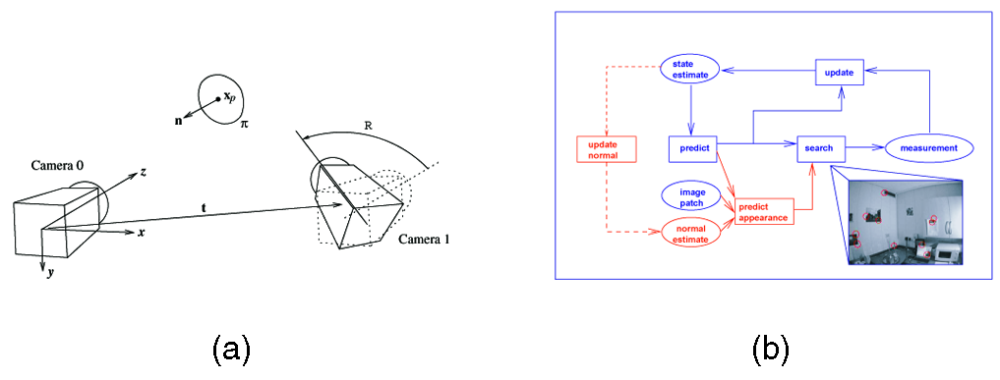

Деформация, связывающая вид фрагмента в двух ракурсах, описывается гомографией:

$$
H =
C R
\left[
(n^\top x_p)I - t n^\top
\right]
C^{-1}.
\tag{12}
$$

Здесь $C$ — матрица калибровки камеры, $R$ и $t$ описывают движение камеры, $n$ — нормаль поверхности, $x_p$ — проекция центра фрагмента, а $I$ — единичная матрица $3 \times 3$.

Сначала система предсказывает внешний вид признака из текущей позиции камеры. Затем стандартным корреляционным поиском находится его 2D-положение в эллиптической области неопределённости. После фиксации положения используется более эффективный шаг выравнивания изображения: вероятностный inverse-compositional gradient descent. Он уточняет параметры деформации, предполагая, что отличие от прогноза невелико.

При добавлении нового признака нормаль поверхности инициализируется параллельно направлению наблюдения, но с большой неопределённостью. Для простоты авторы считают, что оценки нормалей слабо коррелируют с оценками позиций камеры и признаков. Поэтому нормали не хранятся в главном SLAM-векторе состояния, а поддерживаются отдельным двухпараметрическим EKF для каждого признака.


Оценка ориентации лучше работает для крупных фрагментов с богатой текстурой, потому что выравнивание изображения тогда хорошо определяет деформацию. Для простых углов или слабых текстур нормаль оценивается хуже. Но именно для таких признаков точная нормаль менее важна: они часто и так выглядят достаточно инвариантно к изменению ракурса. Авторы рассматривают этот метод как шаг к более полному восстановлению геометрии сцены в реальном времени.

#### Как ориентация патчей выполнена в запускаемом коде

> [!summary] Коротко
> Код использует нормаль патча для вычисления гомографии, но саму нормаль не
> оценивает и не обновляет. Для пяти начальных точек она жёстко задана как
> нормаль плоскости шахматной доски. Отдельного двухпараметрического EKF нормали
> из статьи в проекте нет.

При добавлении начального признака выполняется:

```cpp
// map.cpp, Map::addInitialFeature
double n[] = {0, 0, 1};
Mat normal(3, 1, CV_64FC1, n);

features.push_back(Feature(frame, roi, normal, R, t));
```

Это корректно именно для начальной мишени: мировая плоскость шахматной доски
задана как $z=0$, поэтому её единичная нормаль равна

$$
n^W=\begin{pmatrix}0&0&1\end{pmatrix}^\top.
$$

Объект `Feature` просто сохраняет это значение:

```cpp
normal_.copyTo(normal);
```

При последующем сопоставлении нормаль извлекается без изменения и передаётся в
деформацию патча:

```cpp
Mat p = x(Rect(0, 13 + 3*idx, 1, 3));
Mat n = feature->normal;

Mat templ = camera.warpPatch(
    p, n,
    feature->image, feature->roi,
    feature->R, feature->t,
    R2, t2,
    u, v
);
```

В `Camera::warpPatch()` строится гомография между исходным и текущим видами:

```cpp
Mat H = computeHomography(p, n, K, R1, t1, R2, t2);

Mat warped;
warpPerspective(black, warped, H, view1.size());
```

То есть оценённая поза камеры и известная плоскость патча позволяют предсказать,
как исходный квадратный шаблон должен растянуться, повернуться и изменить форму
в текущем кадре. Уже этот деформированный шаблон используется в
`matchTemplate()`.

Однако в проекте отсутствуют все этапы оценки ориентации из статьи:

- нормаль нового естественного признака не инициализируется вдоль луча;
- параметры нормали и их ковариация не хранятся;
- inverse-compositional gradient descent не реализован;
- невязка деформации не вычисляется;
- отдельный двухпараметрический EKF нормали не создаётся;
- `feature->normal` после создания никогда не обновляется.

У конструктора кандидата даже нет аргумента `normal`:

```cpp
Feature::Feature(
    const Mat& image_, const Rect& roi_,
    const Mat& R_, const Mat& t_, const Mat& dir_,
    const Point2d& depthInterval, int depthSamples
)
```

Пока кандидаты не переводятся в полные признаки, это поле им не требуется. Но
при реализации такого перехода придётся выбрать: добавить оценивание нормали из
статьи или использовать упрощённую фиксированную нормаль и явно ограничить
допустимое изменение ракурса.

> [!important] Фактическая область применимости
> Сейчас гомографическая деформация осмысленна для пяти патчей, лежащих на
> шахматной доске. Для произвольной неплоской сцены код ещё не умеет ни получить
> 3D-точку нового ориентира, ни определить ориентацию локальной поверхности.

Эта доработка хранится в
[[MonoSLAM_технический_долг#8. Проверить соответствие модели ориентации признаков статье]].

#### Что фактически умеет текущий движок после разделов 3.1-3.8

Если собрать рассмотренные части вместе, реальный путь данных выглядит так:

```text
калибровка камеры
        ↓
обнаружение шахматной доски и solvePnP
        ↓
начальное состояние камеры + 5 известных 3D-точек
        ↓
предсказание движения камеры в EKF
        ↓
проекция пяти точек и построение эллипсов поиска
        ↓
гомографическая деформация их исходных патчей
        ↓
корреляционный поиск и EKF-обновление камеры/точек
```

Параллельно программа умеет обнаружить естественные углы и создать для них лучи
с гипотезами глубины, но эта ветвь заканчивается сразу после создания
`candidates`. Поэтому запускаемую версию следует рассматривать как учебное ядро
MonoSLAM с реализованными предсказанием и измерением заранее известных точек, но
с известными дефектами индексации, удаления и численной устойчивости, а не как
полное воспроизведение системы Davison et al. 2007.

## 4. Результаты: интерактивная дополненная реальность

Перед робототехническим применением авторы показывают MonoSLAM в сценарии дополненной реальности. В живое видео с ручной камеры вставляются виртуальные объекты, например предметы мебели. Камера движется по комнате, а виртуальные объекты остаются привязанными к реальной 3D-сцене.

В дополненной реальности графика должна двигаться в изображении так, будто она закреплена в наблюдаемом мире. Для этого нужно точно знать движение камеры. Оценка позы передаётся в 3D-движок, например OpenGL, который правильно отрисовывает виртуальные объекты поверх реального изображения.

MonoSLAM оценивает движение ручной камеры в реальном времени прямо по живому видеопотоку и передаёт эту оценку в движок рендеринга. В отличие от многих предыдущих подходов, системе не нужны магнитные или ультразвуковые датчики, искусственные маркеры в сцене или заранее построенная карта. Авторы утверждают, что это первый подход, который даёт убедительную дополненную реальность в реальном времени без дрейфа в сцене, наблюдаемой впервые.


В реализации стандартное отклонение линейного ускорения в $P_n$ было задано как $10\ \text{м}/\text{с}^2$, то есть примерно одно ускорение свободного падения. Для угловых компонент использовалось $6\ \text{рад}/\text{с}^2$. Эти величины эмпирически описывают камеру, быстро, но плавно перемещаемую рукой. С очень резкими рывками алгоритм справляется плохо.

Использовалась недорогая IEEE 1394 веб-камера с широкоугольным объективом и частотой 30 Гц. Выдержка и усиление настраивались программно, чтобы уменьшить смазывание движения и сохранить контраст. В обычной яркой комнате это практически достижимо.

После инициализации по простой мишени камера перемещалась по небольшой комнате, за несколько секунд динамически строя набор признаков. Затем трекинг продолжался несколько минут, то есть несколько тысяч кадров. Новые признаки добавлялись по необходимости, хотя при повторном посещении уже виденных областей новых признаков требовалось мало. После того как рядом накопилось достаточно признаков, начальную мишень можно было полностью убрать со стены.

Пользователь видел два представления: видеопоток с подсвеченными отслеживаемыми признаками и 3D-вид с оценённым положением камеры и признаков. Щёлкая мышью по трём признакам, пользователь задавал плоскость, к которой можно привязать виртуальный объект. В демонстрации добавлялись предметы виртуальной мебели к двум вертикальным стенам и поверхности столешницы.

В комнатном сценарии алгоритм даёт устойчивую работу в реальном времени при достаточно свободном движении камеры. Если в поле зрения нет полезных признаков, например камера смотрит на пустую стену или потолок, система не может получить измерения. Но она часто переживает периоды, когда видны только два-три признака: неопределённость растёт, а затем уменьшается, когда в кадр возвращается больше ориентиров.

Петли разных размеров замыкаются естественно. Если камера повернулась в новую часть комнаты и вернулась назад, это маленькая петля. Если камера прошла вокруг комнаты, это большая петля. Активный выбор признаков особенно полезен при замыкании: признаки, которые давно не наблюдались и снова вошли в кадр, имеют большую ковариацию инновации $S_i$, поэтому система считает их более информативными и стремится измерить. Это помогает закрывать маленькие петли как можно раньше и не давать неопределённости вырасти до уровня, мешающего большим петлям.

## 5. Результаты: SLAM на гуманоидном роботе

Во втором приложении MonoSLAM используется для робота HRP-2, одной из ведущих гуманоидных платформ того времени. Робот движется по загромождённому indoor-пространству, а MonoSLAM обеспечивает локализацию и построение карты в реальном времени.

У продвинутых гуманоидных роботов обычно есть системы зрения, но к моменту статьи было мало работ по визуальной локализации и картированию для таких платформ. Некоторые подходы использовали стереозрение и визуальную одометрию для оценки движения и плотной реконструкции пола. Локальные оценки движения могли быть хорошими, но без замыкания петель со временем возникал дрейф. Другие работы строили occupancy grid или детектировали плоскости, но опирались на одометрию или искусственные маркеры и потому не были полноценным SLAM.

MonoSLAM строит только разреженную карту точечных ориентиров, а не плотную карту. Но авторы показывают, что даже при сложном 3D-движении с ускорениями можно построить устойчивую карту, которая позволяет локализоваться без дрейфа в небольшой области. Для будущих бытовых или сервисных действий гуманоидов часто важна именно такая повторяемая локализация в пределах комнаты.

### 5.1. Зрение

HRP-2 штатно оснащён высококачественной фронтальной тринокулярной системой, подходящей для точных 3D-измерений в зоне перед роботом, например для захвата и взаимодействия. Но для локализации и построения карты широкое поле зрения полезнее. Поэтому для этой работы HRP-2 дополнительно оснастили широкоугольной камерой с полем зрения около 90 градусов. Для SLAM использовался только её выход.

Широкоугольная камера была откалибрована с радиальной моделью искажения с одним параметром, как в разделе 3.5.

Поскольку робот начинал движение, наблюдая дальнюю стену, для инициализации использовалась смесь естественных и искусственно размещённых признаков с измеренными положениями на этой стене, а не стандартная мишень.

### 5.2. Гироскоп

HRP-2 оснащён трёхосевым гироскопом в груди, который выдаёт измерения угловой скорости тела с частотой 200 Гц. Хотя MonoSLAM мог работать только на зрении, наличие такого датчика было полезно включить в оценивание. Гироскоп уменьшал рост неопределённости при движении по петлям.

Данные гироскопа дискретизировались до частоты зрения 30 Гц и использовались внутри SLAM-фильтра. Стандартное отклонение каждой компоненты угловой скорости оценивалось как $0.01\ \text{рад}/\text{с}$. Поскольку вектор состояния MonoSLAM уже содержит угловую скорость робота в его системе координат, эти измерения можно включить прямо как внутреннее измерение состояния: дополнительный шаг обновления Калмана перед визуальной обработкой.

### 5.3. Результаты

Авторы провели эксперимент, в котором робот шёл по окружности радиуса 0.75 м. Это был настоящий SLAM-тест: робот исследовал новые области и в конце замыкал одну большую петлю.

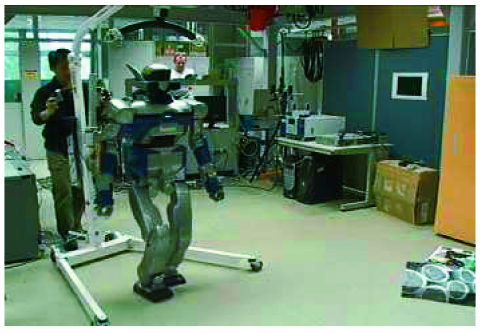

Для безопасности движение было разделено на пять частей с короткими остановками: сначала диагональное движение вправо без поворота, затем четыре дуговых поворота влево по 90 градусов, где робот шёл по круговой траектории. Общее время ходьбы было около 30 секунд, но SLAM продолжал трекинг на 30 Гц и во время остановок.


Наблюдается классическое поведение SLAM: неопределённость новых признаков постепенно растёт, пока ранний признак не будет увиден снова. После замыкания петли дрейф исправляется, и большое число признаков одновременно сдвигается в более согласованные положения благодаря корреляциям в ковариационной матрице. Такая карта уже пригодна для долгосрочного использования: робот может проходить петли многократно без накопления ошибки локализации.

## 6. Детали системы

### 6.1. Проверка по ground truth

Для оценки точности локализации авторы провели эксперимент в типичной среде. Камера, параметры модели движения и частота 30 Гц были такими же, как в демонстрации дополненной реальности.

На горизонтальном столе с разными объектами была точно размечена прямоугольная траектория. В одном углу находилась стандартная мишень инициализации, задающая начало и ориентацию мировой системы координат. Больше о сцене ничего заранее не было известно.

К ручной камере прикрепили отвес известной длины. Камеру двигали так, чтобы груз отвеса почти скользил по размеченной траектории. Поэтому 3D-координаты камеры в четырёх угловых точках были известны с точностью около 1 см.

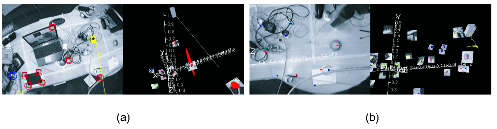

После короткого начального движения, во время которого строилась первая карта, камеру по очереди перемещали к четырём углам прямоугольника и останавливали. Ниже приведены истинные координаты и усреднённые оценки MonoSLAM по нескольким повторным петлям. Значения после $\pm$ — стандартные отклонения оценок.

| Точка | Ground truth x, м | Ground truth y, м | Ground truth z, м | Оценка x, м | Оценка y, м | Оценка z, м |
|---:|---:|---:|---:|---:|---:|---:|
| 1 | 0.00 | 0.00 | -0.62 | $0.00 \pm 0.01$ | $0.01 \pm 0.01$ | $-0.64 \pm 0.01$ |
| 2 | -1.00 | 0.00 | -0.62 | $-0.93 \pm 0.03$ | $0.06 \pm 0.02$ | $-0.63 \pm 0.02$ |
| 3 | -1.00 | 0.50 | -0.62 | $-0.98 \pm 0.03$ | $0.46 \pm 0.02$ | $-0.66 \pm 0.02$ |
| 4 | 0.00 | 0.50 | -0.62 | $0.01 \pm 0.01$ | $0.47 \pm 0.02$ | $-0.64 \pm 0.02$ |

На таком масштабе MonoSLAM обычно даёт точность локализации в несколько сантиметров, а «дрожание» оценки составляет около 1-2 см. Некоторые координаты, например среднее значение $x=-0.93$ м во второй точке, имеют систематическую ошибку больше кратковременного дрожания. При повторных проходах она уменьшается медленно, примерно на 1 см за петлю, поскольку вероятностный SLAM постепенно приводит карту к согласованности.

### 6.2. Вычислительные требования

На процессоре Pentium M 1.6 ГГц типичная разбивка времени обработки одного кадра при 30 Гц выглядела так. При 30 Гц на кадр доступно около 33 мс.

| Операция | Время |
|---|---:|
| Загрузка изображения и служебная обработка | 2 мс |
| Корреляционный поиск по изображению | 3 мс |
| Обновление фильтра Калмана | 5 мс |
| Поиск при инициализации признака | 4 мс |
| Графический рендеринг | 5 мс |
| Итого | 19 мс |

Это показывает, что 30 Гц достигаются с запасом. Такой запас полезен, потому что время обработки меняется от кадра к кадру, а пропуск кадров желательно избегать. Авторы предполагают, что переход к 60 Гц в ближайшем будущем возможен, если упростить графический рендеринг или выполнять его с меньшей частотой.

### 6.3. Программное обеспечение

Системы из статьи построены на C++-библиотеке SceneLib. Примеры приложений MonoSLAM реального времени доступны как open-source проект под лицензией LGPL на странице Scene:

[http://www.doc.ic.ac.uk/~ajd/Scene/](http://www.doc.ic.ac.uk/~ajd/Scene/)

### 6.4. Видео

Видео с результатами из статьи доступны в каталоге:

[http://www.doc.ic.ac.uk/~ajd/Movies/](http://www.doc.ic.ac.uk/~ajd/Movies/)

Файлы, указанные авторами:

1. `kitchen.mp4.avi` — базовый метод и дополненная реальность;
2. `CircleHRP2.mpg` — внешний вид движения гуманоидного робота;
3. `hrploopclose.mpg` — вывод MonoSLAM для гуманоидного робота с замыканием петли.

## 7. Заключение

В статье объяснён MonoSLAM — алгоритм одновременной локализации и построения карты в реальном времени для одной свободно движущейся камеры. Главные принципы подхода: вероятностная карта, модель движения, активные измерения и разреженная карта признаков высокого качества.

Эффективность достигается активным поиском признаков: система не тратит обработку на всё изображение, а ищет только там, где признаки вероятны. Это по-настоящему байесовский top-down-подход.

Авторы показали экспериментальные реализации, демонстрирующие широкую применимость MonoSLAM: недорогая робототехника, продвинутые роботы, носимые вычисления, дополненная реальность для промышленности и развлечений, а также пользовательские интерфейсы.

В будущей работе авторы планируют улучшать алгоритм для более крупных сред, indoor и outdoor, более динамичных движений и более сложных сцен с окклюзиями, сложными объектами и меняющимся освещением. При этом они хотят сохранить жёсткую работу в реальном времени, использование обычных камер и минимум предположений.

Один путь развития — камеры с частотой выше 30 Гц. У активного поиска есть важное преимущество: удвоение частоты кадров не обязательно удваивает объём обработки изображения, потому что области поиска становятся меньше из-за меньшей неопределённости движения. Уже тогда существовали CMOS IEEE 1394 камеры, способные давать 100 Гц на полном разрешении и ещё выше в программируемых окнах.

Второе направление — переход от разреженных карт к более плотным и структурированным представлениям. Например, можно пытаться обнаруживать поверхности и другие объекты более высокого уровня. Работа по оценке ориентации фрагментов показывает, что это возможно без отказа от реального времени.

Третье направление — масштабирование на очень большие среды через подкарты. Но для визуальных признаков остаётся неочевидным, как аккуратно делить карту на смысловые подблоки. Возможно, будут полезны инвариантные признаки вроде SIFT для сопоставления подкарты или более высокоуровневые 3D-элементы сцены, например крупные поверхности.

## Благодарности

Основная часть работы была выполнена, когда Andrew J. Davison, Ian D. Reid и Nicholas D. Molton работали вместе в Active Vision Laboratory, University of Oxford. Авторы благодарят David Murray, Ben Tordoff, Walterio Mayol, Nobuyuki Kita и других коллег из Oxford, AIST и Imperial College London за обсуждения и совместную работу над программным обеспечением. Также они благодарят Kazuhito Yokoi из JRL за поддержку с HRP-2.

Исследование поддерживалось грантами EPSRC `GR/R89080/01` и `GR/T24685`, EPSRC Advanced Research Fellowship для Andrew J. Davison, а также финансированием CNRS/AIST в JRL.

## Список литературы

Список литературы сохранён в исходном виде, чтобы не искажать названия публикаций.

[1] A.W. Fitzgibbon and A. Zisserman, “Automatic Camera Recovery for Closed or Open Image Sequences,” Proc. European Conf. Computer Vision, pp. 311-326, June 1998.

[2] M. Pollefeys, R. Koch, and L.V. Gool, “Self-Calibration and Metric Reconstruction in Spite of Varying and Unknown Internal Camera Parameters,” Proc. Sixth Int’l Conf. Computer Vision, pp. 90-96, 1998.

[3] “2d3 Web Based Literature,” URL [http://www.2d3.com/](http://www.2d3.com/), 2005.

[4] A. Rahimi, L.P. Morency, and T. Darrell, “Reducing Drift in Parametric Motion Tracking,” Proc. Eighth Int’l Conf. Computer Vision, pp. 315-322, 2001.

[5] A.J. Davison, “Real-Time Simultaneous Localisation and Mapping with a Single Camera,” Proc. Ninth Int’l Conf. Computer Vision, 2003.

[6] A.J. Davison, Y.G. Cid, and N. Kita, “Real-Time 3D SLAM with Wide-Angle Vision,” Proc. IFAC Symp. Intelligent Autonomous Vehicles, July 2004.

[7] N.D. Molton, A.J. Davison, and I.D. Reid, “Locally Planar Patch Features for Real-Time Structure from Motion,” Proc. 15th British Machine Vision Conf., 2004.

[8] C.G. Harris and J.M. Pike, “3D Positional Integration from Image Sequences,” Proc. Third Alvey Vision Conf., pp. 233-236, 1987.

[9] N. Ayache, Artificial Vision for Mobile Robots: Stereo Vision and Multisensory Perception. MIT Press, 1991.

[10] P.A. Beardsley, I.D. Reid, A. Zisserman, and D.W. Murray, “Active Visual Navigation Using Non-Metric Structure,” Proc. Fifth Int’l Conf. Computer Vision, pp. 58-65, 1995.

[11] R. Smith, M. Self, and P. Cheeseman, “A Stochastic Map for Uncertain Spatial Relationships,” Proc. Fourth Int’l Symp. Robotics Research, 1987.

[12] P. Moutarlier and R. Chatila, “Stochastic Multisensory Data Fusion for Mobile Robot Location and Environement Modelling,” Proc. Int’l Symp. Robotics Research, 1989.

[13] J.J. Leonard, “Directed Sonar Sensing for Mobile Robot Navigation,” PhD dissertation, Univ. of Oxford, 1990.

[14] J. Manyika, “An Information-Theoretic Approach to Data Fusion and Sensor Management,” PhD dissertation, Univ. of Oxford, 1993.

[15] S. Betgé-Brezetz, P. Hébert, R. Chatila, and M. Devy, “Uncertain Map Making in Natural Environments,” Proc. IEEE Int’l Conf. Robotics and Automation, 1996.

[16] M. Csorba, “Simultaneous Localisation and Mapping,” PhD dissertation, Univ. of Oxford, 1997.

[17] J.A. Castellanos, “Mobile Robot Localization and Map Building: A Multisensor Fusion Approach,” PhD dissertation, Universidad de Zaragoza, Spain, 1998.

[18] A.J. Davison, “Mobile Robot Navigation Using Active Vision,” PhD dissertation, Univ. of Oxford, 1998.

[19] P.M. Newman, “On the Structure and Solution of the Simultaneous Localization and Map Building Problem,” PhD dissertation, Univ. of Sydney, 1999.

[20] M. Bosse, P. Newman, J. Leonard, M. Soika, W. Feiten, and S. Teller, “An Atlas Framework for Scalable Mapping,” Proc. IEEE Int’l Conf. Robotics and Automation, 2003.

[21] P.M. Newman and J.J. Leonard, “Consistent Convergent Constant Time SLAM,” Proc. Int’l Joint Conf. Artificial Intelligence, 2003.

[22] M. Montemerlo, S. Thrun, D. Koller, and B. Wegbreit, “FastSLAM: A Factored Solution to the Simultaneous Localization and Mapping Problem,” Proc. AAAI Nat’l Conf. Artificial Intelligence, 2002.

[23] P.M. Newman, J.J. Leonard, J. Neira, and J. Tardós, “Explore and Return: Experimental Validation of Real Time Concurrent Mapping and Localization,” Proc. IEEE Int’l Conf. Robotics and Automation, pp. 1802-1809, 2002.

[24] K. Konolige and J.-S. Gutmann, “Incremental Mapping of Large Cyclic Environments,” Proc. Int’l Symp. Computational Intelligence in Robotics and Automation, 1999.

[25] S. Thrun, W. Burgard, and D. Fox, “A Real-Time Algorithm for Mobile Robot Mapping with Applications to Multi-Robot and 3D Mapping,” Proc. IEEE Int’l Conf. Robotics and Automation, 2000.

[26] J. Neira, M.I. Ribeiro, and J.D. Tardos, “Mobile Robot Localisation and Map Building Using Monocular Vision,” Proc. Int’l Symp. Intelligent Robotics Systems, 1997.

[27] A.J. Davison and D.W. Murray, “Mobile Robot Localisation Using Active Vision,” Proc. Fifth European Conf. Computer Vision, pp. 809-825, 1998.

[28] A.J. Davison and D.W. Murray, “Simultaneous Localization and Map-Building Using Active Vision,” IEEE Trans. Pattern Analysis and Machine Intelligence, vol. 24, no. 7, pp. 865-880, July 2002.

[29] A.J. Davison and N. Kita, “3D Simultaneous Localisation and Map-Building Using Active Vision for a Robot Moving on Undulating Terrain,” Proc. IEEE Conf. Computer Vision and Pattern Recognition, 2001.

[30] I. Jung and S. Lacroix, “High Resolution Terrain Mapping Using Low Altitude Aerial Stereo Imagery,” Proc. Ninth Int’l Conf. Computer Vision, 2003.

[31] J.H. Kim and S. Sukkarieh, “Airborne Simultaneous Localisation and Map Building,” Proc. IEEE Int’l Conf. Robotics and Automation, pp. 406-411, 2003.

[32] M. Bosse, R. Rikoski, J. Leonard, and S. Teller, “Vanishing Points and 3D Lines from Omnidirectional Video,” Proc. IEEE Int’l Conf. Image Processing, 2002.

[33] R.M. Eustice, H. Singh, J.J. Leonard, M. Walter, and R. Ballard, “Visually Navigating the RMS Titanic with SLAM Information Filters,” Proc. Robotics: Science and Systems, 2005.

[34] R. Sim, P. Elinas, M. Griffin, and J.J. Little, “Vision-Based SLAM Using the Rao-Blackwellised Particle Filter,” Proc. IJCAI Workshop Reasoning with Uncertainty in Robotics, 2005.

[35] D.G. Lowe, “Object Recognition from Local Scale-Invariant Features,” Proc. Seventh Int’l Conf. Computer Vision, pp. 1150-1157, 1999.

[36] N. Karlsson, E.D. Bernardo, J. Ostrowski, L. Goncalves, P. Pirjanian, and M.E. Munich, “The vSLAM Algorithm for Robust Localization and Mapping,” Proc. IEEE Int’l Conf. Robotics and Automation, 2005.

[37] P.F. McLauchlan and D.W. Murray, “A Unifying Framework for Structure and Motion Recovery from Image Sequences,” Proc. Fifth Int’l Conf. Computer Vision, 1995.

[38] A. Chiuso, P. Favaro, H. Jin, and S. Soatto, “MFm: 3-D Motion from 2-D Motion Causally Integrated over Time,” Proc. Sixth European Conf. Computer Vision, 2000.

[39] D. Nistér, O. Naroditsky, and J. Bergen, “Visual Odometry,” Proc. IEEE Conf. Computer Vision and Pattern Recognition, 2004.

[40] E. Foxlin, “Generalized Architecture for Simultaneous Localization, Auto-Calibration and Map-Building,” Proc. IEEE/RSJ Conf. Intelligent Robots and Systems, 2002.

[41] D. Burschka and G.D. Hager, “V-GPS(SLAM): Vision-Based Inertial System for Mobile Robots,” Proc. IEEE Int’l Conf. Robotics and Automation, 2004.

[42] E. Eade and T. Drummond, “Scalable Monocular SLAM,” Proc. IEEE Conf. Computer Vision and Pattern Recognition, 2006.

[43] J. Shi and C. Tomasi, “Good Features to Track,” Proc. IEEE Conf. Computer Vision and Pattern Recognition, pp. 593-600, 1994.

[44] R. Swaminathan and S.K. Nayar, “Nonmetric Calibration of Wide-Angle Lenses and Polycameras,” IEEE Trans. Pattern Analysis and Machine Intelligence, vol. 22, no. 10, pp. 1172-1178, 2000.

[45] A.J. Davison, “Active Search for Real-Time Vision,” Proc. 10th Int’l Conf. Computer Vision, 2005.

[46] J. Solà, M. Devy, A. Monin, and T. Lemaire, “Undelayed Initialization in Bearing Only SLAM,” Proc. IEEE/RSJ Conf. Intelligent Robots and Systems, 2005.

[47] J.M.M. Montiel, J. Civera, and A.J. Davison, “Unified Inverse Depth Parametrization for Monocular SLAM,” Proc. Robotics: Science and Systems, 2006.

[48] H. Jin, P. Favaro, and S. Soatto, “A Semi-Direct Approach to Structure from Motion,” The Visual Computer, vol. 19, no. 6, pp. 377-394, 2003.

[49] N.D. Molton, A.J. Davison, and I.D. Reid, “Parameterisation and Probability in Image Alignment,” Proc. Asian Conf. Computer Vision, 2004.

[50] S. Baker and I. Matthews, “Lucas-Kanade 20 Years on: A Unifying Framework: Part 1,” Int’l J. Computer Vision, vol. 56, no. 3, pp. 221-255, 2004.

[51] V. Lepetit and P. Fua, “Monocular Model-Based 3D Tracking of Rigid Objects: A Survey,” Foundations and Trends in Computer Graphics and Vision, vol. 1, no. 1, pp. 1-89, Oct. 2005.

[52] K. Kaneko, F. Kanehiro, S. Kajita, H. Hirukawa, T. Kawasaki, M. Hirata, K. Akachi, and T. Isozumi, “Humanoid Robot HRP-2,” Proc. IEEE Int’l Conf. Robotics and Automation, 2004.

[53] Y. Takaoka, Y. Kida, S. Kagami, H. Mizoguchi, and T. Kanade, “3D Map Building for a Humanoid Robot by Using Visual Odometry,” Proc. IEEE Int’l Conf. Systems, Man, and Cybernetics, pp. 4444-4449, 2004.

[54] K. Sabe, M. Fukuchi, J.-S. Gutmann, T. Ohashi, K. Kawamoto, and T. Yoshigahara, “Obstacle Avoidance and Path Planning for Humanoid Robots Using Stereo Vision,” Proc. IEEE Int’l Conf. Robotics and Automation, 2004.

[55] P.M. Newman and K. Ho, “SLAM Loop-Closing with Visually Salient Features,” Proc. IEEE Int’l Conf. Robotics and Automation, 2005.

## Биографии авторов

### Andrew J. Davison

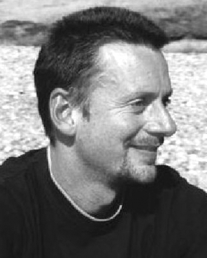

Andrew J. Davison изучал физику в University of Oxford и получил степень BA в 1994 году. В докторской работе в Robotics Research Group под руководством David Murray он разработал одну из первых робототехнических SLAM-систем на основе зрения. После получения DPhil в 1998 году он получил EU Science and Technology Fellowship и два года работал в AIST в Японии, развивая исследования визуальной навигации роботов. В 2000 году он вернулся в Oxford к постдокторской работе с Ian Reid, в 2002 году получил пятилетнюю EPSRC Advanced Research Fellowship, а в 2005 году перешёл в Imperial College London. Его работа сосредоточена на технологиях локализации и построения карты в реальном времени с помощью зрения и их применении в робототехнике.

### Ian D. Reid

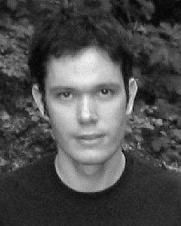

Ian D. Reid получил BSc в University of Western Australia в 1987 году, затем поступил в University of Oxford как Rhodes Scholar и получил DPhil в 1991 году. Он занимал должность reader in engineering science в University of Oxford и был fellow Exeter College. Его исследования связаны с компьютерным зрением, особенно с обработкой в реальном времени: визуальным отслеживанием, визуальным управлением активными роботизированными платформами, геометрией зрения, самокалибровкой камер, захватом движения человека и распознаванием активности.

### Nicholas D. Molton

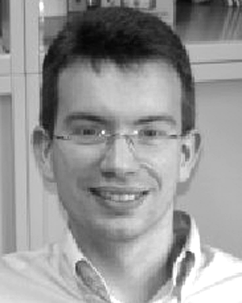

Nicholas D. Molton получил степень BEng по инженерии в Brunel University и DPhil по робототехнике в University of Oxford. Он работал в областях, связанных со Structure from Motion и оцениванием, в University of Oxford и 2d3 Ltd. На момент статьи работал vision scientist в Imagineer Systems в Guildford, United Kingdom. Его недавняя работа была связана с приложениями в индустрии визуальных эффектов. Он разделил Emmy Award, полученную 2d3 за технический вклад в телевидение в 2002 году.

### Olivier Stasse

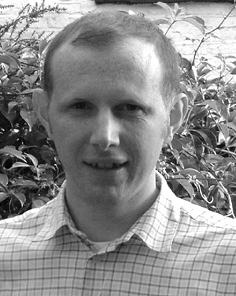

Olivier Stasse получил MSc по operations research в 1996 году и PhD по intelligent systems в 2000 году в University of Paris 6. Он был assistant professor of computer science в University of Paris 13. Его интересы включают гуманоидных роботов, распределённые вычисления и вычисления реального времени применительно к задачам зрения в сложных робототехнических системах. Он участвовал в проекте гуманоидной робототехники Yasuo Kuniyoshi в Tokyo University, работал в L2TI, затем присоединился к SONY robot-soccer team в Laboratoire de Robotique de Versailles. С 2003 года был участником Joint French-Japanese Robotics Laboratory как исследователь CNRS. Он является членом IEEE и IEEE Computer Society.
